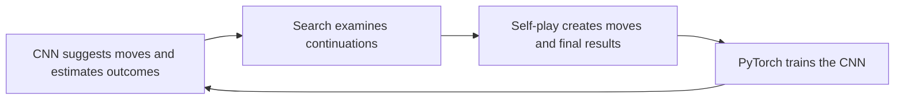

# How AlphaBlokus works

AlphaBlokus combines a **residual convolutional neural network (CNN)**,
**Monte Carlo tree search (MCTS)** and **self-play training**, following the
broad AlphaZero approach. It plays four-player Classic Blokus on20×20 boards.
The public source and published model graph were checked; its playing strength
and reported training cost have not been independently reproduced here.

The CNN receives four numerical grids, one for each player's occupied squares,
and adds horizontal/vertical coordinate grids. Boards rotate and player channels
are reordered to the current player's perspective. The published model has64
feature channels and10 residual blocks, each with two3×3 convolutions. A block
adds a learned refinement back to its input, helping deeper networks train.

A separate4×21 inventory input says which pieces each player still has. A small
dense network turns that into feature-map scales and offsets, called FiLM. It
lets a board arrangement be interpreted differently depending on available pieces.

The **policy head** outputs91×20×20 placement scores; Rust filters illegal moves.
The **value head** outputs four outcome estimates; tied winners share the credit.

MCTS balances estimated value with exploration, applies moves in copied games,
asks the CNN about new positions, and backs up values and visit counts. The
checked playing configuration uses2,000 simulations per move. A simulation
usually stops at a neural evaluation rather than finishing a random game.

The policy learns the search visit distribution; the value learns the eventual
game outcome. Updated networks play the next games. The checked training setup
runs1,024 concurrent games, GPU batches128, cheap200-simulation searches on80%
of moves and full1,000-simulation searches on20%. Only full searches are saved
as training examples. Pentobi supplies a benchmark, not demonstrations in that
published self-play configuration.

For our project, the useful lessons are a deeper CNN, enough concurrent CPU games
to feed GPU batches, and much more self-play data. Our Duo experiment adapts those
ideas to14×14 boards, two players and the existing verified Rust rules.

For exact source links, model metadata, implementation details and limitations,
see [the source study](alphablokus-study.md).
