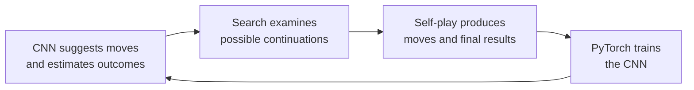

# AlphaBlokus: the CNN, search and self-play loop

**Yes—AlphaBlokus uses both a CNN and search, connected through an AlphaZero-style self-play loop.** I checked its source code and the published model’s ONNX graph. It targets **four-player Blokus on a20×20 board**.

The overall loop is:

Its CNN receives the board as **four numerical grids**, one for each player’s occupied squares. It adds two coordinate grids indicating horizontal and vertical position. The board is rotated and the player channels reordered so the network always sees the position from the current player’s perspective.

The published network has **64 feature channels and10 residual blocks**, each containing two3×3 convolutions. A residual block learns a refinement and adds it back to its input: roughly, `output = input + learned_refinement`. These “skip connections” help deeper networks train. For comparison, our experimental CNN currently has four convolutions in its main body. [Network implementation](https://github.com/ShivamSarodia/AlphaBlokus/blob/b4470ef9667e7c6f000a0542bb3aaa4d5cce1292/python/src/alphablokus/res_net_film.py).

It also receives **which pieces each player still has**, as4×21 indicators. A small dense network converts these into adjustments to the CNN’s feature maps. This technique is called **FiLM**. It lets the network interpret the same board arrangement differently depending on the remaining pieces—for example, whether a useful shape could still fit into a gap. [Model configuration](https://github.com/ShivamSarodia/AlphaBlokus/blob/b4470ef9667e7c6f000a0542bb3aaa4d5cce1292/configs/train_live/vast_film.toml).

The network then splits into two **heads**:

| Head | What it produces |
|---|---|
| **Policy** | Scores for oriented piece placements: a91×20×20 grid. Rust determines legality and filters the choices. |
| **Value** | Four outcome estimates, one per player. Tied winners share the winning credit. |

I verified those input/output dimensions against the [published model graph](https://github.com/ShivamSarodia/AlphaBlokus/blob/b4470ef9667e7c6f000a0542bb3aaa4d5cce1292/static/browser/026025784.onnx).

**Search turns those initial guesses into a more considered move.** Its Monte Carlo tree search repeatedly:

1. Chooses a promising branch, balancing estimated value with exploration.
2. Applies moves in copies of the Rust game.
3. Asks the CNN to evaluate a newly reached position, or uses the actual result if the game has ended.
4. Updates the branch’s values and visit counts.

It ultimately chooses using those visit counts. The checked playing configuration uses **2,000 search simulations per move**. Here, a simulation usually ends at a neural evaluation; it needn’t play a whole random game to completion. [Search implementation](https://github.com/ShivamSarodia/AlphaBlokus/blob/b4470ef9667e7c6f000a0542bb3aaa4d5cce1292/crates/mcts-core/src/search.rs).

**The training labels come from self-play.** The policy learns the search’s visit distribution; the value learns the eventual game outcome. Those updates improve the network used in subsequent games.

Its efficiency choices are particularly relevant to us: the checked configuration runs **1,024 concurrent games**, feeding GPU batches of **128 positions**. It uses cheaper200-simulation searches for80% of moves and1,000-simulation searches for the remainder. Only the full searches are recorded as training examples. [Self-play configuration](https://github.com/ShivamSarodia/AlphaBlokus/blob/b4470ef9667e7c6f000a0542bb3aaa4d5cce1292/configs/self_play/full_mcts_vast.toml).

We subsequently tested a similar ten-block residual network: it lost to our small CNN at the supplied budget. That result and the newer training/transfer evidence are covered in the [architecture comparison](architecture-comparison.md). **AlphaBlokus's described training starts without Pentobi demonstrations**; Pentobi supplies a benchmark. I verified the architecture, but haven’t independently reproduced its playing strength or reported training cost.

The fuller explanation and source references are in [our AlphaBlokus study](alphablokus-study.md).
