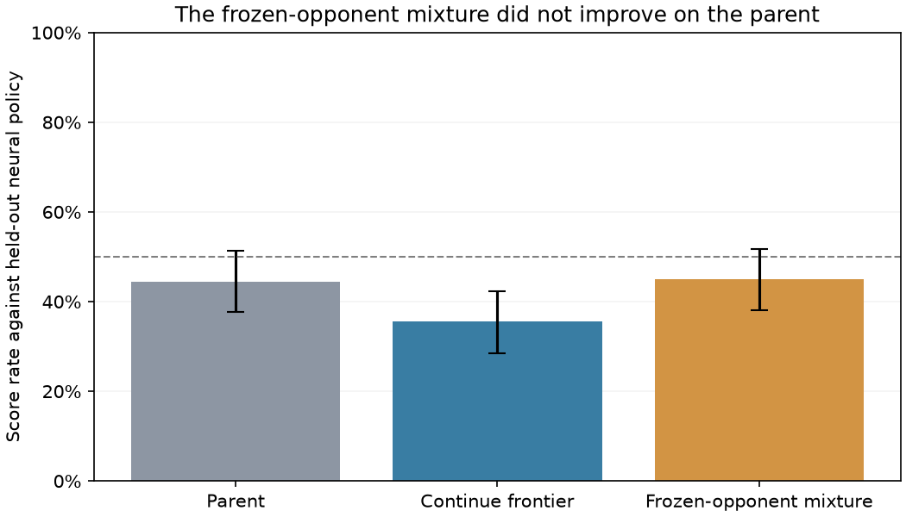

# Frozen-neural curriculum results

This matched experiment failed its predeclared success conditions. Both arms used the same parent, 9,600 games, selection rule and fresh final tests. The initial policies and final test-opening digests match exactly.

| Policy | Random score | Largest score | Frontier score | Known neural score | Held-out neural score |
|---|---|---|---|---|---|
| parent | 99.12% | 82.12% | 73.38% | 55.75% | 44.50% |
| control selected | 97.50% | 77.38% | 65.50% | 46.75% | 35.50% |
| mixed selected | 99.00% | 86.50% | 61.88% | 50.75% | 45.00% |

Mixed held-out score gain versus parent: +0.5 percentage points (paired 95% interval −8.5 to +9.5 points). Versus control: +9.5 points (interval +0.75 to +18.5 points).

The mixed policy improved relative to the regressing control but did not improve materially over the parent, and its frontier score fell by 11.5 percentage points. Validation-selected checkpoints regressed on fresh tests. This could reflect forgetting, limited validation samples or representation limitations; this experiment does not establish the cause.

The frozen-reference mixture is not a demonstrated improvement. Preserve the earlier selected models. [Declared protocol](blokus-duo-frozen-league-protocol.md). Detailed JSON artifacts are under `runs/duo-frozen-league-{control,mixed}-442/`.
