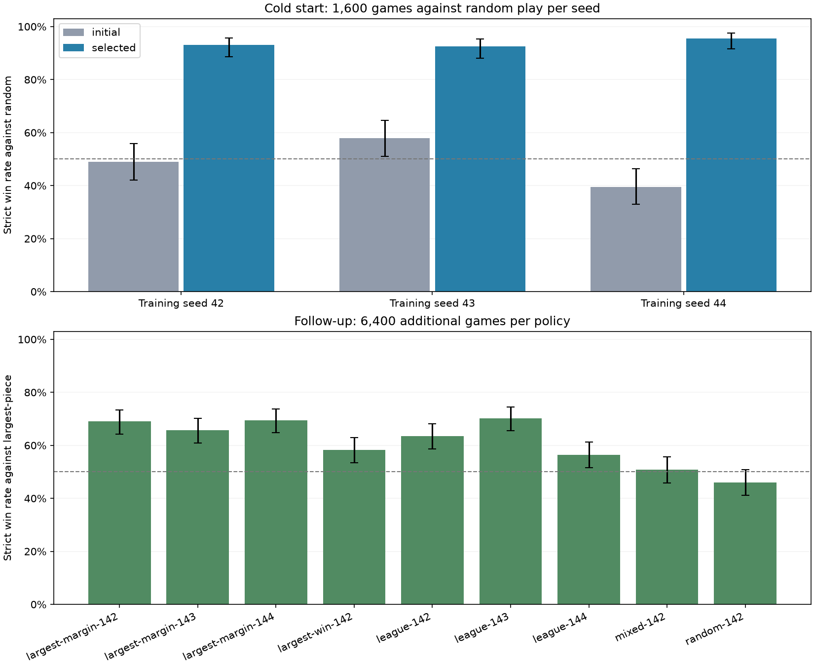
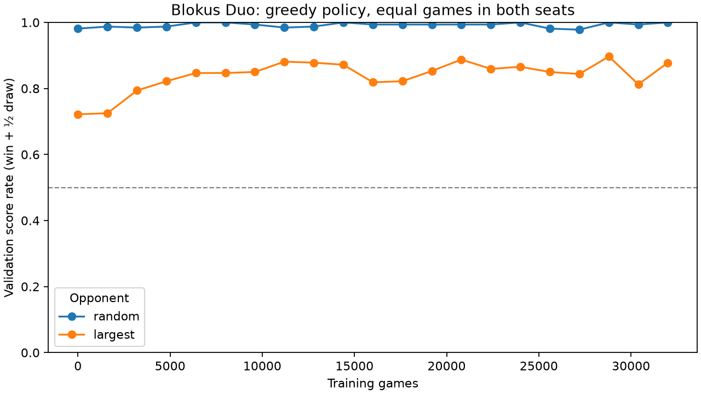
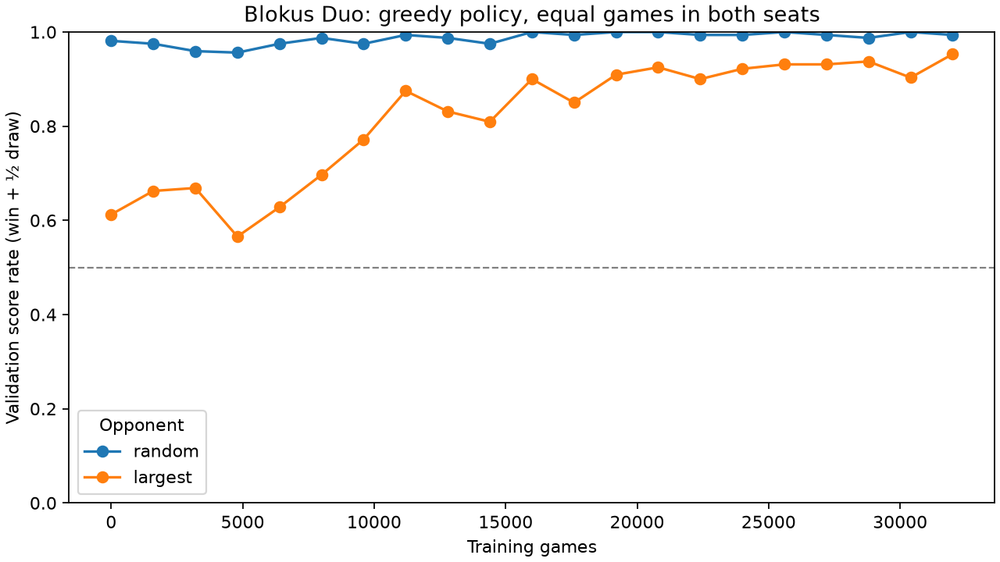

# Blokus Duo results

Generated from saved summary.json files. Each policy was selected on validation
games before the held-out tests below. W/D/L count strict wins, draws and losses.
The learner is greedy; neural opponents sample their frozen distributions.

## Cold-start pilots

Each pilot starts from random weights and trains for 1,600 games against random
legal play. Different seeds independently initialize weights and experience.

| Seed | Initial vs random W/D/L | Selected vs random W/D/L | Selected vs largest W/D/L | Selected vs sampled initial W/D/L |
|---|---|---|---|---|
| 42 | 98/10/92 | 186/3/11 | 99/7/94 | 188/2/10 |
| 43 | 116/9/75 | 185/1/14 | 96/8/96 | 180/3/17 |
| 44 | 79/8/113 | 191/0/9 | 118/8/74 | 189/3/8 |

Each entry has 200 games, balanced between seats. All three pilots improve
against random and their sampled initial policy. This is a small cold-start
learning result; it does not establish human-level play.

## Follow-up curricula

Each follow-up adds 6,400 games. Seed 142 arms share the seed-42 pilot parent.
League seeds 143/144 use independent pilot parents 43/44. Selection maximizes
mean validation score rate against random and largest-piece play. The margin
arm changes the learning objective to terminal score difference / 109.

| Run | Selected update | vs random W/D/L | vs largest W/D/L | Largest strict-win 95% interval | Largest wins by seat 0 / 1 |
|---|---|---|---|---|---|
| largest-margin-142 | 180 | 388/3/9 | 276/12/112 | 64.3%–73.3% | 78.5% / 59.5% |
| largest-margin-143 | 120 | 391/1/8 | 263/13/124 | 61.0%–70.2% | 69.5% / 62.0% |
| largest-margin-144 | 100 | 387/2/11 | 278/12/110 | 64.8%–73.8% | 80.0% / 59.0% |
| largest-win-142 | 180 | 380/4/16 | 233/16/151 | 53.4%–63.0% | 65.0% / 51.5% |
| league-142 | 120 | 383/2/15 | 254/14/132 | 58.7%–68.1% | 73.0% / 54.0% |
| league-143 | 180 | 393/3/4 | 281/9/110 | 65.6%–74.5% | 81.5% / 59.0% |
| league-144 | 120 | 386/0/14 | 226/15/159 | 51.6%–61.3% | 66.0% / 47.0% |
| mixed-142 | 200 | 382/2/16 | 203/19/178 | 45.9%–55.6% | 52.5% / 49.0% |
| random-142 | 20 | 367/2/31 | 184/19/197 | 41.2%–50.9% | 58.0% / 34.0% |

Follow-up entries have 400 games each, balanced between seats. The intervals
describe game sampling uncertainty for a fixed policy/opponent, not uncertainty
across training seeds. These arms are exploratory comparisons; test results
informed later hypotheses, which use new final test seeds.

## Longer-budget training

`duo-longer-margin-242` adds 32,000 games; selected update 900.
The parent and selected checkpoint are tested on the same fresh seeds.

| Policy | Opponent | W/D/L | Strict-win 95% interval |
|---|---|---|---|
| initial | random | 1951/13/36 | 96.8%–98.1% |
| initial | largest | 1380/57/563 | 66.9%–71.0% |
| selected | random | 1973/2/25 | 98.0%–99.1% |
| selected | largest | 1738/36/226 | 85.4%–88.3% |

Declared improvement criterion: **passed**; largest-opponent win-rate change +17.9%.

The curve shows validation data; the table above shows held-out tests.

## Longer-budget training

`duo-longer-margin-243` adds 32,000 games; selected update 1000.
The parent and selected checkpoint are tested on the same fresh seeds.

| Policy | Opponent | W/D/L | Strict-win 95% interval |
|---|---|---|---|
| initial | random | 1953/6/41 | 96.9%–98.2% |
| initial | largest | 1218/78/704 | 58.7%–63.0% |
| selected | random | 1983/4/13 | 98.6%–99.5% |
| selected | largest | 1827/31/142 | 90.0%–92.5% |

Declared improvement criterion: **passed**; largest-opponent win-rate change +30.4%.

The curve shows validation data; the table above shows held-out tests.

## Longer-budget training

`duo-longer-margin-244` adds 32,000 games; selected update 550.
The parent and selected checkpoint are tested on the same fresh seeds.

| Policy | Opponent | W/D/L | Strict-win 95% interval |
|---|---|---|---|
| initial | random | 1953/4/43 | 96.9%–98.2% |
| initial | largest | 1382/75/543 | 67.0%–71.1% |
| selected | random | 1973/3/24 | 98.0%–99.1% |
| selected | largest | 1647/41/312 | 80.6%–84.0% |

Declared improvement criterion: **passed**; largest-opponent win-rate change +13.3%.

The curve shows validation data; the table above shows held-out tests.

## Frontier curriculum

`duo-frontier-training-342` adds 6,400 games against frontier, with observation version 2.
Selected update 140; validation selection balances largest and frontier.

| Policy | Opponent | W/D/L | Strict-win 95% interval |
|---|---|---|---|
| initial | random | 395/1/4 | 97.1%–99.5% |
| initial | largest | 348/9/43 | 83.3%–89.9% |
| initial | frontier | 189/18/193 | 42.4%–52.1% |
| selected | random | 393/0/7 | 96.4%–99.1% |
| selected | largest | 331/10/59 | 78.7%–86.1% |
| selected | frontier | 293/10/97 | 68.7%–77.4% |

Declared improvement criterion: **passed**; frontier win-rate change +26.0%.

## Frontier curriculum

`duo-frontier-training-343` adds 6,400 games against frontier, with observation version 2.
Selected update 180; validation selection balances largest and frontier.

| Policy | Opponent | W/D/L | Strict-win 95% interval |
|---|---|---|---|
| initial | random | 396/2/2 | 97.5%–99.6% |
| initial | largest | 364/4/32 | 87.8%–93.4% |
| initial | frontier | 225/9/166 | 51.4%–61.0% |
| selected | random | 392/1/7 | 96.1%–99.0% |
| selected | largest | 320/8/72 | 75.8%–83.6% |
| selected | frontier | 279/17/104 | 65.1%–74.0% |

Declared improvement criterion: **passed**; frontier win-rate change +13.5%.

## Frontier curriculum

`duo-frontier-training-344` adds 6,400 games against frontier, with observation version 2.
Selected update 120; validation selection balances largest and frontier.

| Policy | Opponent | W/D/L | Strict-win 95% interval |
|---|---|---|---|
| initial | random | 390/1/9 | 95.5%–98.6% |
| initial | largest | 321/7/72 | 76.1%–83.9% |
| initial | frontier | 210/12/178 | 47.6%–57.3% |
| selected | random | 396/1/3 | 97.5%–99.6% |
| selected | largest | 336/7/57 | 80.1%–87.3% |
| selected | frontier | 254/7/139 | 58.7%–68.1% |

Declared improvement criterion: **passed**; frontier win-rate change +11.0%.

## Held-out geometric baseline

The frontier baseline maximizes piece area, then own-minus-opponent empty
corner anchors, then breaks ties randomly. It was excluded from training
and checkpoint selection for the runs above. This is one-ply heuristic
evaluation, not a trained policy or a perfect opponent.

| Match | W/D/L | Strict-win 95% interval |
|---|---|---|
| frontier-vs-largest | 155/7/38 | 71.2%–82.7% |
| margin-vs-frontier | 81/10/109 | 33.9%–47.4% |
| longer-vs-frontier | 93/4/103 | 39.7%–53.4% |

The first runs used observation version 1. Version 2 appends current scores
and pass count so the completion bonus and exact pass transition are visible.
Old policies load with zero weights on the new inputs; four benchmark
rechecks reproduced identical W/D/L and score margins after migration.

## What the evidence supports

- We can train neural Blokus Duo policies from random initialization with the same PyTorch/TorchRL stack.
- Baseline choice matters: beating random is easier than beating largest-piece play.
- Compare selected and final checkpoints; additional training can regress.
- These finite benchmarks cannot certify optimality, broad robustness or human-level strength.

No human demonstrations, minimax targets or tree-search policy targets were used for these runs.
Largest/mixed curricula use a handcrafted opponent, which is a declared source
of human domain knowledge. The league uses sampled historical neural policies.

The original pilot deterministic-neural match repeated only two trajectories.
It was corrected to sampled neural opponents; original summaries are preserved
as summary-before-neural-opponent-fix.json and are superseded.

## Reproduce

See [pilot protocol](blokus-duo-protocol.md),
[follow-up protocol](blokus-duo-curriculum-protocol.md), and
[training walkthrough](blokus-duo.md). Run artifacts and weights live under
the ignored runs/ directory; the source tree does not bundle model weights.

Rebuild this report with `uv run blokus-rl duo-report`.
