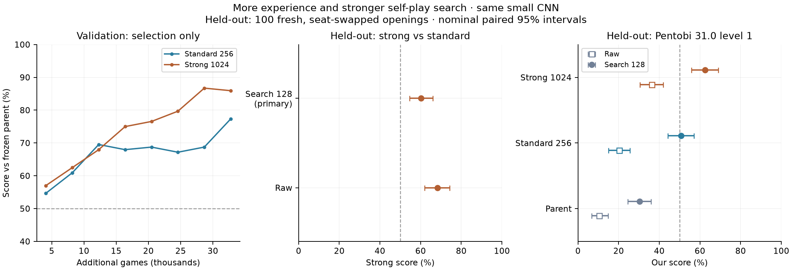

# Controlled Blokus Duo continuation — results, 26 October 2026

**Stronger self-play search improved this small CNN, and the resulting search agent beat Pentobi level 1 on the reserved test.** Both continuations improved over their shared parent. This is progress in Duo, not evidence that we have reached the Blokus frontier.

The prespecified primary result was **60.25%** for strong1024 against standard256 at **128 playing simulations each** (nominal paired 95% interval **54.50%–66.00%**). Its lower bound exceeds 50%, meeting the declared success criterion for this parent/seed.



## Held-out comparisons

Each row is 200 games:100 fresh four-ply random openings, replayed in both seats, seed2589000. Score = (wins + half draws)/games. Raw selects directly from the network; search128 uses the same network with 128 tree-search simulations per move. Models were selected on separate validation openings and frozen before this test book was generated. Margins are final score differences from the named first agent's perspective.

| Comparison | W/D/L | Score | Nominal paired 95% interval | Mean margin |
| --- | ---: | ---: | ---: | ---: |
| Strong vs standard · search128 | 116/9/75 | 60.25% | 54.50%–66.00% | 2.54 |
| Strong vs standard · raw | 131/11/58 | 68.25% | 62.00%–74.25% | 4.74 |

| Comparison | W/D/L | Score | Nominal paired 95% interval | Mean margin |
| --- | ---: | ---: | ---: | ---: |
| Standard 256 vs parent · raw | 139/10/51 | 72.00% | 66.75%–77.50% | 5.80 |
| Standard 256 vs parent · search128 | 146/7/47 | 74.75% | 68.25%–80.75% | 5.76 |
| Strong 1024 vs parent · raw | 157/8/35 | 80.50% | 75.50%–85.50% | 9.56 |
| Strong 1024 vs parent · search128 | 149/13/38 | 77.75% | 72.25%–83.00% | 7.87 |

## External opponent: Pentobi 31.0 level 1

| Comparison | W/D/L | Score | Nominal paired 95% interval | Mean margin |
| --- | ---: | ---: | ---: | ---: |
| Parent · raw | 18/6/176 | 10.50% | 6.75%–14.75% | -13.48 |
| Parent · search128 | 51/19/130 | 30.25% | 24.50%–36.00% | -7.20 |
| Standard 256 · raw | 38/5/157 | 20.25% | 15.00%–25.50% | -8.62 |
| Standard 256 · search128 | 95/13/92 | 50.75% | 44.25%–57.00% | -1.62 |
| Strong 1024 · raw | 69/7/124 | 36.25% | 30.50%–42.00% | -3.00 |
| Strong 1024 · search128 | 121/8/71 | 62.50% | 55.75%–69.00% | 1.60 |

Pentobi used one thread, no opening book and no resignation. Its final margins were cross-checked by the Rust engine during play; this report independently replayed all 1,200 saved external games. All three agents faced the same fresh openings, seats and per-game Pentobi seeds. The earlier CPU float32 levels 1–9 ladder tested the parent on a different book; those numbers are not a controlled before/after comparison with these CUDA bfloat16 results.

Same-book score differences below resample the same opening indices together. Units are percentage points; these are secondary comparisons.

| Difference against Pentobi | Mode | Score difference | Nominal paired 95% interval |
| --- | --- | ---: | ---: |
| standard256-vs-parent | raw | +9.75pp | +3.00 to +16.50pp |
| standard256-vs-parent | search128 | +20.50pp | +11.50 to +29.25pp |
| strong1024-vs-parent | raw | +25.75pp | +18.75 to +32.75pp |
| strong1024-vs-parent | search128 | +32.25pp | +23.00 to +41.25pp |
| strong1024-vs-standard256 | raw | +16.00pp | +8.50 to +23.75pp |
| strong1024-vs-standard256 | search128 | +11.75pp | +2.75 to +20.75pp |

## What was trained and selected

Both branches inherited the same 52,978-parameter four-layer CNN, AdamW optimizer moments and 100,000 replay positions from the parent's 32,768 ancestral games. A declared fresh seed 865 starts additional pure self-play; no Pentobi moves, external demonstrations or heuristic rewards were used for learning.

On 80% of moves both branches used 32 simulations; these roots were not recorded. On the remaining 20%, standard used 256 simulations and strong used 1,024. Only these full-search roots entered replay. Shared GPU inference served six CPU self-play workers, 32 live games each, batch limit 256, leaf batch 8. Learning retained replay 100,000, approximately three examples/new root, minibatch 256, AdamW lr 0.001, policy CE weight 0.5 plus terminal win/draw/loss value MSE and gradient clipping 1.

Every 16 rounds, each branch faced the parent on 32 validation opening pairs, seed 2583000, at 128 simulations each. The unchanged parent was also a selectable candidate at 50%. The best validation checkpoint was frozen; validation scores below are selected results, not held-out strength estimates.

| Actual additional budget | Standard256 | Strong1024 |
| --- | ---: | ---: |
| Games generated | 32,768 | 32,768 |
| Full-search roots recorded | 228,636 | 228,639 |
| Gradient updates | 2,739 | 2,748 |
| Gradient training examples | 701,184 | 703,488 |
| Search simulations (fast + full) | 87,904,544 | 263,393,152 |
| Neural inference positions | 74,847,457 | 207,406,513 |
| Mean shared inference batch | 85.61 | 78.11 |
| Elapsed training seconds | 6326.93 | 15953.60 |
| Selected additional round | 128 | 112 |
| Games through selected round | 32,768 | 28,672 |
| Roots through selected round | 228,636 | 200,038 |
| Updates through selected round | 2,739 | 2,406 |
| Best validation score | 77.34% | 86.72% |

Both arms finished 128 rounds / 32,768 additional games at the round limit, within their 2-hour / 5-hour soft caps. Each latest lineage has 65,536 ancestral + new games; the selected strong checkpoint is from additional round 112 (28,672 new games; 61,440 including its ancestor), while the selected standard is from round 128. The final 16 strong rounds were generated but not selected. Equal generated-game budgets do not mean equal compute, gradient examples or selected-checkpoint experience. Stronger search also changes trajectories and terminal outcomes, so this tests the whole search-budget treatment rather than target quality alone. Neural inference positions are not gradient training examples.

## Frozen-parent playing-search diagnostics

Before learning, the unchanged parent played itself on 24 separate diagnostic pairs (48 games), seed 2581000. These measure extra playing search, not learning gains or strength against Pentobi.

| Comparison | W/D/L | Score | Nominal paired 95% interval | Mean margin |
| --- | ---: | ---: | ---: | ---: |
| Parent search512 vs parent search128 | 35/0/13 | 72.92% | 62.50%–83.33% | 6.52 |
| Parent search2048 vs parent search128 | 44/2/2 | 93.75% | 87.50%–98.96% | 9.12 |

## Hardware, costs and execution

One L40S, 8 capped CPU cores, 24 GiB capped RAM; bfloat16 inference/training with TF32 permitted for applicable float32 operations. The bounded function took 23,644.10 seconds (6.57 hours); app lifetime including startup/shutdown was23,736 seconds. No training cap mismatch, provider preemption, retry or scientific-protocol change occurred. A separate 16-game CUDA interruption/recovery smoke passed and its weights were discarded. The CLI's final-log-reader timeout happened after finished.json was committed and the app stopped successfully; it was not a failed experiment.

Provider metering for this app at the saved billing snapshot is **$16.57150713**, versus the conservative **$22.74661 reservation** and **$25 phase ceiling**. Account billing can lag; the reservation is not a charge. The workspace summary at that snapshot is $29.14137374 metered, $0.00 billed after credits/allowances. Against the original $130 allowance, approximately$100.86 remains before later storage/metering adjustments. The$50 reserve stays uncommitted; no new compute was launched.

Across 4,688 telemetry samples (all phases, startup included), mean GPU busy was 4.9%, 95th percentile 6.0%; peak used VRAM was 741/46,068MiB. Compute utilization and occupied GPU memory describe different things. The training table reports actual batching and end-to-end elapsed time, not an extrapolated GPU-only throughput.

## Verification and practical limits

Verified frozen file hashes against both heldout-protocol.json and finished.json, branch initial weights against the unchanged parent, the unchanged parent optimizer/replay hash, final atomic states against latest weights and inherited+additional optimizer steps, all 128 progress rows/arm, checkpoint selection from validation, and all 12 held-out pair summaries (2,400 games). All1,200 external action traces replayed legally with matching scores and outcomes; external actor search totaled 1,187,456 simulations. Head-to-head evaluations saved paired outcomes and aggregate margins but no action traces, so independent replay is available for the external games only. Preserved certified tic-tac-toe and frontier342 hashes also pass.

Intervals use 10,000 whole-opening bootstrap resamples, seed 17. They quantify opening sampling for fixed selected models, not training-seed, parent-lineage, scheduling, precision or hardware uncertainty. Secondary comparisons are nominal and not multiplicity adjusted. Both branches share one parent and one new seed; this is not independent replication. Random four-ply openings define a particular test distribution, not an empty-board tournament or all possible play. We beat level 1 here; we have not benchmarked the new checkpoint against levels 2–9. Pentobi simulation counts and neural-leaf search simulations are not interchangeable measures of work. No human Elo is inferred.

No AlphaBlokus matches were run. Its inspected agent is for four-player Classic; Duo strength does not establish the Classic frontier. Sensible next work would replicate this training treatment and benchmark the frozen strong agent against higher Pentobi levels, while checking whether its now stronger learned policy changes the benefit of deeper playing search. Those are proposals, not automatically launched jobs.

## Artifacts and reproduction

- Downloaded complete private run: `runs/duo-continuation-final-20261026T2007/duo-continuation-865`.
- Verification and derived budgets: `runs/duo-continuation-final-20261026T2007/verification.json`; all downloaded file hashes: `runs/duo-continuation-final-20261026T2007/download-sha256.json`.
- App: `ap-DQEFQZzvb7k0kP8eAjXRWz`; source commit, exact payload/runner hashes, lineage hashes and reservation are retained in execution.json and runs/modal-continuation-cost-ledger.jsonl.
- Selected standard SHA256: `4cbeb255cb5688a6b931ac4ac6964f21e3c6430be2e6dd558e6d7c9a14d43b19`.
- Selected strong SHA256: `95569be7c179180c12681255dbcee9884f465e713f418e958a508907beb4d512`.
- The rolling protocol, launch command and original source hashes are in [continuation-status.md](continuation-status.md). Training is finished; do not rerun the launch command.

Regenerate the audit/report/plot locally without training or evaluation:

```sh
MPLCONFIGDIR=.cache/matplotlib .venv/bin/python -m blokus_rl.duo_continuation_report \
  --run runs/duo-continuation-final-20261026T2007/duo-continuation-865 \
  --parent runs/duo-deep-local-764/conv.pt \
  --parent-state runs/duo-deep-study-764-download-20261026T0634/duo-deep-study-764/conv/resume.pt \
  --preserved runs/search-preserved-checkpoints.json \
  --billing runs/blokus-billing-report-final-20261026.json \
  --billing-summary runs/blokus-billing-summary-final-20261026.json \
  --apps runs/blokus-apps-final-20261026.json \
  --out docs/continuation-results.md
```
