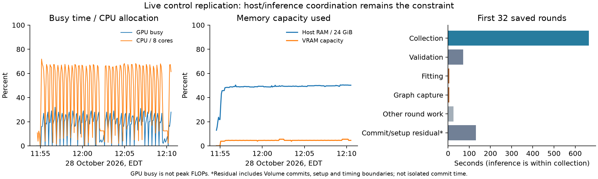
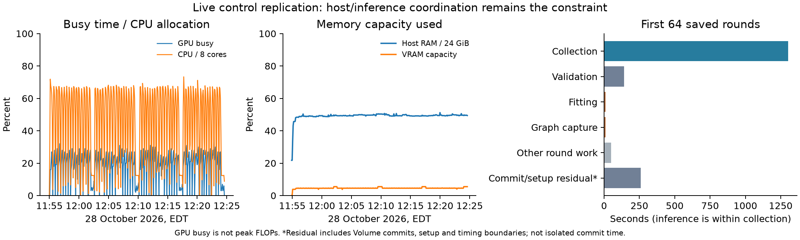

# Live performance profile and small copy optimization — 28 October 2026

The existing seed-1071 replication remains active with its original pinned runtime. Profiling used its existing L40S container; no new app, training run, model upload, game or gradient was launched. A small result-copy optimization is implemented locally and CUDA-checked for subsequent deployment. It has **not been injected into the active experiment**.

## Resource and phase measurements

The first snapshot spans **11:54:33–12:10:30 EDT**, with 191 existing five-second telemetry samples and the first 32 saved rounds (8,192 games). Telemetry and committed progress have slightly different endpoints. This reports performance counters without interpreting partial strength scores.

| Resource | Measurement |
|---|---:|
| GPU busy | Mean 16.8%, median 20%, p95 28% |
| CPU use / allocation | 3.57 / 8 cores on average |
| Peak host RAM / cap | 12.11 / 24 GiB |
| Peak VRAM / device capacity | 2,699 / 49,140 MiB |
| GPU memory-controller busy | Mean 0.80% |

GPU busy measures time with active kernels, not peak FLOPs or occupancy. Memory capacity is not exhausted; host DRAM bandwidth was not measured. The CPU average is container-wide CPU time divided by sampled wall time.

A separate 45-second read-only sample during ordinary self-play used **4.34 of 8 cores**, with **16.2% mean GPU busy**, 11.81–11.89 GiB host RAM and 2,267 MiB peak VRAM. The main training process averaged .714 cores and the six workers .581–.620 each. Shared process RSS is not summed as physical RAM. This sample includes checkpoint gaps and the small sampler overhead. `py-spy`, `perf` and `nsys` were unavailable; no native/CUDA stack trace was collected.

| First 32 saved rounds | Seconds |
|---|---:|
| Self-play collection | 664.79 |
| Inference-service wrapper (within collection) | 390.72 |
| Gradient fitting | 5.32 |
| Scheduled validation | 71.06 |
| Graph capture | 5.68 |
| Other timed round work, including serialization | 25.04 |
| Outside-round residual: commits/setup/timing boundaries | 131.20 |

The inference-service wrapper occupies **58.8% of collection wall time**. It includes staging, transfers, neural execution, synchronization and output handling. These are overlapping counters: its time must not be added to collection. Actual GPU batches averaged **85.39 / 256** positions. Only 5.32 seconds went to optimizer work.

The evidence points to latency and coordination in the host/search/inference path, plus persistence gaps. Spare aggregate CPU and GPU capacity do not imply that a larger GPU or more cores alone will help. Exact function-level attribution needs a further trace or more phase-specific timers. The approximately 131-second residual includes Volume commits, setup and timing-boundary effects; it is **not an isolated commit-time measurement**. Changing checkpoint frequency or overlapping persistence needs separate recovery/durability validation.

## Implemented small result-copy improvement

`GraphBucket` now retains NumPy views of its persistent pinned output buffers, avoiding repeated Tensor slicing/conversion on every result. For sufficiently padded batches it copies only the contiguous active row prefix from GPU to host. The 64 KiB savings threshold keeps small-copy cases on the simple full-buffer path; views are cached by prefix length. Caller-visible results still own their arrays, finite checks remain, and the CUDA stream is synchronized before CPU access. This preserves the ordering described in [PyTorch’s transfer guidance](https://docs.pytorch.org/tutorials/intermediate/pinmem_nonblock.html) and the [`copy_` API](https://docs.pytorch.org/docs/2.14/generated/torch.Tensor.copy_.html).

A synthetic copy-only diagnostic ran in a separate process inside the existing container. All methods used matching `no_grad` wrappers, four repetitions in reversed order, 150 calls per repetition after warm-up. The selected method is an exact AST-body match to the implemented `finish` method. The study ran concurrently, so these are component measurements under shared load.

| Active rows / bucket; width bucket | Original µs/call | Improved µs/call | Component time reduction |
|---|---:|---:|---:|
| 1 / 8; 64 | 22.32 | 16.90 | 24.3% |
| 24 / 32; 256 | 24.34 | 18.66 | 23.3% |
| 85 / 128; 1024 | 55.25 | 43.13 | 21.9% |
| 129 / 256; 2048 | 154.67 | 105.25 | 31.9% |
| 256 / 256; 2048 | 262.15 | 249.91 | 4.7% |

These save roughly **5–49 microseconds per tested copy call**, about **5–32% of that component**. They do not establish a whole-collection speedup: host packing, search, queues and neural work remain. The matched diagnostic measurement loop took 1.31 seconds, excluding process/framework startup. A preliminary probe with mismatched wrapper overhead is retained in the raw directory and **excluded** from the table.

Eight focused Python tests passed, covering staging contracts, exact returned values, padding, changing batch sizes, output ownership and nonfinite checks. The complete candidate module also passed **exact CUDA Graph output equality and output-lifetime checks on four alternating synthetic batch/width cases**, with no games or optimizer steps. Those checks ran in a separate diagnostic process using fresh synthetic weights. The original study model and code were left untouched. The existing 19-file image/payload remains pinned to its original hashes; a future deployment must explicitly rebuild/validate its payload before selecting this optimization.

The running process cannot pick up a local disk edit. Keeping its frozen runtime preserves the prespecified replication and source audit. Its completed performance report will include profiling overhead and any phase changes. No additional benchmark or training study is launched automatically.

## Evidence and monitoring

Raw telemetry/progress, the read-only process sample, preliminary and matched copy probes, and exact CUDA comparison are under `runs/control-replication-profile-20261028T161033Z/`. `cloud/profile_result_copies.py` reproduces the bounded synthetic diagnostic. `cloud/report_live_performance.py --snapshot <directory>` recomputes the saved counters/figure. The figure was visually inspected.

The completion follow-up also watches performance/phase changes quietly and will attach the final phase/cost summary. The $11 phase cap and $50 credit reserve remain. Profiling uses capacity in the existing allocation, so its overhead is included in provider metering; the short synthetic probes can transiently affect GPU/CPU telemetry. Report those limits when comparing times with prior runs.

## Completed training-phase profile

Training finished **all 64 rounds / 16,384 games at 12:24:40 EDT**; held-out
evaluation then started. A second snapshot bounds resource readings by the remote
initialization-audit and completed-training file timestamps, **11:54:53–12:24:40
EDT**. It contains 355 existing samples. This includes initial setup/commit time,
validation, persistence and the brief separate profiling processes; it does not
isolate only neural inference.

| Whole training window | Measurement |
|---|---:|
| GPU busy: mean / median / p95 | 17.34% / 21% / 29% |
| CPU allocation used | 3.63 / 8 cores |
| Peak host RAM | 12.29 / 24 GiB |
| Peak VRAM | 2,699 / 49,140 MiB |
| Collection / inference service within collection | 1301.78s / 775.75s (59.6%) |
| Gradient fitting / validation / graph capture | 10.20s / 140.29s / 10.34s |
| Other timed round work / commit-setup boundary residual | 48.93s / 260.06s |
| Mean actual inference batch | 85.52 / 256 |
| Actual training simulations / neural positions | 131,365,216 / 102,833,751 |
| Gradient steps | 1,366 |

The model-generation phase remains constrained by the search/inference pipeline
and persistence overhead, with spare hardware capacity. The copy patch addresses
one measured component. Its whole-workload benefit still needs a fixed-work
collection comparison before selecting it for a future cloud payload. The
residual is not a direct measurement of Volume commit time.

Raw full-phase snapshot:
`runs/control-replication-profile-training-20261028T162752Z/`. Both resource
figures were visually inspected. At 12:26 EDT the app still had one task; the
previous integrated app was stopped. Account metering was **$54.44137374** across
all work, not a per-study charge. Profiling did not add a separate paid app or
increase the existing $11 ceiling. Final billing will be refreshed at closeout.

## Final phase profile and stop confirmation

The helper completed at **12:56:24 EDT**, the wrapper at **12:56:26**, and the app
stopped with zero tasks at **12:56:42**. All 64 training rounds and 1,200 held-out
games completed. Whole-function telemetry has **738 samples**: GPU busy mean
**18.23%**, p95 **38%**; CPU mean **2.24 of 8 cores**; peak host RAM **12.29/24 GiB**;
peak VRAM **2,699/49,140 MiB**. These mixed phases include the short profiling
probes and cannot be read as peak-FLOP utilization or a pure collection profile.

| Provider-log phase | Wall seconds | GPU busy mean | CPU cores mean | Peak host RAM GiB |
|---|---:|---:|---:|---:|
| Training and setup | 1800.00 | 17.2% | 3.61 | 12.29 |
| Parent vs Pentobi 3 | 341.00 | 25.9% | 0.96 | 6.63 |
| Parent vs Pentobi 4 | 404.00 | 19.5% | 0.92 | 6.63 |
| Control vs Pentobi 3 | 346.00 | 24.2% | 0.94 | 6.62 |
| Control vs Pentobi 4 | 350.00 | 27.6% | 0.96 | 6.62 |
| Searched control–parent | 457.00 | 4.5% | 1.00 | 7.35 |
| Raw control–parent | 4.32 | One sample only | — | 7.13 |

Phase boundaries come from one-second-resolution provider log timestamps and
include commits/setup. The raw phase has only one five-second telemetry sample,
so its resource averages are not interpretable. The separately bounded training
window above starts at the initialization-audit marker, explaining the small
sampling difference from the training/setup log phase.

The searched head-to-head path averaged about one CPU core and 4.5% GPU busy;
its implementation differs from the six-worker self-play collector. Increasing
GPU capacity alone would not address its serial host path. Additional evaluation
parallelism and separately timed persistence are useful future measurements,
subject to preserving seeds, search accounting and recovery guarantees. No new
benchmark is launched here.

`runs/control-replication-final-20261028T171624Z/analyze-phases.py` recomputes
`phase-performance.json` from timestamped logs and raw telemetry. The final
strength comparison is inconclusive against Pentobi 4; the full result and
interpretation are in [the replication report](control-replication.md). The
$2.62553148 provider app cost includes profiling in this allocation; no separate
profiling app or extra games/gradients were launched. The original frozen runtime
was preserved throughout. The copy patch remains locally staged and requires a
whole-collection comparison before future cloud selection.

All raw evidence, reports, figures, source and final artifacts are covered by
the member-hash-verified final backup. Compute is stopped, protected models are
unchanged, and the shared completion/performance follow-up is removed at closeout.

Final refreshed CLI snapshots confirm all returned apps stopped with zero tasks,
provider app cost **$2.62553148**, and account meter **$55.51137374** below the
$80 allowance. All 35 protected checkpoint hashes and all 454 downloaded run-member
hashes were rechecked before archival. No additional paid work is scheduled.
