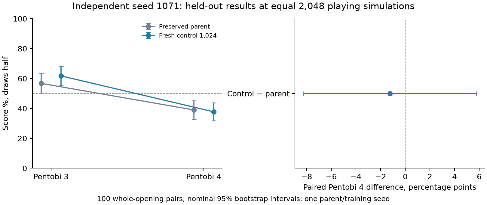

# Independent control replication — seed 1071

**Completed at 12:56 EDT on 28 October 2026 and independently verified locally.**
All 16,384 training games and all 1,200 held-out games finished. Compute is stopped.

The fresh control scored **37.75%** against Pentobi 4, versus the retested
parent’s **39.0%**: **−1.25 percentage points**, nominal paired 95% interval
**−8.25 to +5.75**. The primary improvement criterion was not met; this comparison
is **inconclusive**, not evidence of an established loss to the parent. The
control’s absolute level-4 interval, **31.75%–43.75%**, is below 50%, so the
majority-score stretch goal was not met. The earlier Pentobi-4 gain was not
reproduced under this fresh seed/book.

The selected control did beat the parent head-to-head with equal playing search:
**58.0% score [51.5%, 64.5%]**. Its raw score was **49.0% [42.5%, 55.25%]**,
inconclusive. These opponent-specific results do not establish a general ranking.

Dennis authorized the completed study’s recommendation on 28 October: test one
independent training seed and fresh book using the cheaper 1,024-search recipe.
The run started from the original preserved parent. Its total provider app
metering was **$2.62553148**, versus **$10.29461 reserved under an $11 ceiling**.
The protected $50 reserve is retained. No further experiment was launched.

The original control improved its Pentobi-4 score by 13.75 percentage points
(nominal whole-opening 95% interval +5.5 to +22.25). That result motivated this
replication; its test games are not reused or pooled as new observations.

## Prespecified method and success

One new seed, **1071**, plans 64 rounds × 256 = **16,384 additional self-play
games**. Scientific settings match the earlier control except training,
validation and test seeds. The initial model is the selected round-112 CNN
(SHA256 `95569be7c179180c12681255dbcee9884f465e713f418e958a508907beb4d512`),
with fresh AdamW and the complete 100,000-position replay from the later round-128
state (`df74afa8bf699eb63f9dcf4d32cd13530e7b276f66c63ddd28368049edf75911`).
The later replay and shared parent limit independence; this is training-seed
replication, not an independent model lineage or training from scratch.

Recorded 20% of moves use full search 1,024; unrecorded 80% use fast search 32.
Six workers × 64 live games use shared-memory bulk inference, compact Rust
indices, ready batching, CUDA Graphs and cache disabled. Inference batch 256,
leaf batch 8, zero wait, CUDA bfloat16/TF32, replay 100,000, training ratio 3,
minibatch 256, AdamW learning rate .001 / weight decay .0001, policy CE .5 plus
terminal WDL MSE, gradient clip 1. The soft training cap is 6,000 seconds; report
any cap-bound work honestly. No architecture or runtime change is being tested.

Validation every 16 rounds uses 32 pairs, seed **2608300**, against the frozen
parent at 512 simulations each. The unchanged parent remains selectable at 50%
(additional round 0, despite embedded update 112). Selected weights freeze before
any held-out book is generated. Tests use **100 fresh four-ply opening pairs,
seed 2608900**, both seats:

- Parent and selected control each against pinned Pentobi 31.0 Duo levels 3 and 4,
  at exactly 2,048 playing simulations: **800 external games with full traces**.
- Selected control against parent at 2,048 each and raw: **400 head-to-head games**
  with paired outcomes/counters, without saved action traces.

Finish every prespecified case regardless of intermediate scores. The primary
criterion is control-minus-parent Pentobi-4 draw-half score difference whose
**nominal whole-opening 95% interval lies entirely above zero**. An interval
crossing zero is inconclusive; entirely below zero is negative evidence. A
control absolute Pentobi-4 interval entirely above 50% is a stretch goal, not a
condition for stopping. Raw/search and validation/test results remain separate.

Report this fresh result alongside seed 1070 without treating different books
as a matched comparison or pooling games as independent training replicates.
There are only two training seeds total, sharing one parent and warm replay;
checkpoint selection and multiple nominal intervals further limit claims. No
human Elo, Classic/frontier or AlphaBlokus claims. No next experiment is automatic.

The complete frozen configuration is in `control-replication-protocol.json`.
The validated immutable runtime image is `im-yX3zmnEKl2EgUtndThw9li`; native SHA256
`257b5a55c2c9fefcf3af5f15e240c7b18245abe49c44b781956b2b5351dac30e`.
Only the new launcher and study helper source are uploaded; model/replay stay in
the existing private Volume. The 19 inherited payload hashes remain pinned to the
completed GPU validation. Initial replay content/order, parent tensors, fresh
optimizer and fresh RNG receive a retained audit record before training starts.

## Budget and completion

One L40S, eight capped CPU cores, 24 GiB RAM, **four-hour hard limit**, retries 0,
max one container. Phase ceiling **$11**; reservation **$10.29461**, comprising
four hours plus 90 seconds at $2.5204/hour and $0.15 build allowance. Reservation
is not actual spend. The account last metered $53.03137374; the launcher uses a
conservative $54 floor and checks total commitment below $80, retaining **$50 of
the original $130 credits**. No top-up or plan change.

Ledger: `runs/modal-control-replication-cost-ledger.jsonl`. The local ledger and
exclusive private run directory block duplicate submission/infrastructure replay.
No automatic retry or recovery. On failure preserve atomic states and logs,
report the blocker and stop. Existing studies and checkpoints remain unchanged;
`runs/control-replication-preserved-before.json` pins their protected hashes.

After both finished markers and stopped app / zero tasks, download to a new,
pre-created unused local parent. Run:

```sh
MPLCONFIGDIR=.cache/matplotlib .venv/bin/python -m blokus_rl.duo_control_replication_report \
  --run <complete-run-root> --apps <stopped-apps.json> \
  --app-id <app-id> --billing <billing-report.json>
```

The auditor launches no games. It checks source/runtime/native/model lineage,
fresh initial optimizer/replay/RNG, selection, all gradient/game/search counters,
and independently replays all 800 external traces. It recomputes every paired
summary and audits the 400 head-to-head outcomes/counters without claiming action
replay. All-zero scores use a conservative one-sided paired upper bound.
`cloud/write_control_replication_results.py --verification <verification.json>`
writes the compact report and figure; inspect the plot and add interpretation,
actual costs, limitations and a recommendation. Check CLI billing including all
attempts, stopped apps and preserved models. Back up with
`cloud/backup_control_replication.py --name <unused> --run <download-parent>`;
every archive member must pass SHA256 readback. Commit locally without pushing,
report the final result here, and delete the completion follow-up.

## Launch and follow-up

Submitted **28 October 2026 at 11:53 EDT** (15:53 UTC):

- App `ap-oDPcA20WshoYQlqxcurDXF`; call `fc-01M61KFFT1D23GBPCZQJJP7PV6`.
- Run `duo-control-replication-1071`, profile `linuxfan2718`, existing private
  Volume `blokus-deep-selfplay-20261026`.
- Executed source commit `f4a3dd5eae44537731c4e37dd01ee93ee353d1e7`.
- Provider confirmed the exact child SDK/Volume commit probe and started the
  independent control branch. One active container; previous study stopped.
- Offline paid-launch guard tests: four passed. Only the three declared seed
  fields differ from the earlier control configuration; new validation/test books
  do not overlap that run's books. All 35 protected checkpoint hashes passed.
  The initial replay-content digest was checked locally, and report/plot generation
  passed a temporary historical-fixture smoke test; that fixture is not new evidence.
- Reservation is $10.29461 under the $11 ceiling. Actual metering is reported at
  completion. Expected work is roughly 75–100 minutes based on the earlier run;
  this is an estimate, with a four-hour maximum function lifetime.
- A quiet completion follow-up audits, reports, backs up and commits the result,
  then deletes itself. Partial training/validation scores are not final evidence.

Startup verification at **11:56 EDT** read committed initialization/status records:
parent tensors, all inherited replay content/order, empty AdamW state and fresh
CPU/NumPy RNG matched locally; one CUDA RNG state was retained. Three rounds /
768 new games were committed. These are health/counter checks, not strength
results. Snapshot: `runs/control-replication-startup-snapshot-20261028T155635Z/`.
Initial source/receipt backup `.backups/control-replication-startup-20261028.tar.gz`
read back all 41 members successfully (SHA256
`e24466e8b1620d8848eb2919860dcc0656f2b851e8bff22c0214e45372193874`).

The [live performance report](control-replication-performance.md) covers the
completed training phase and the small local result-copy improvement. Training
finished all 16,384 games at **12:24:40 EDT** and held-out evaluation started.
The active study retains its original pinned runtime; the copy patch is staged
for subsequent deployment. The shared completion follow-up also monitors
performance/phase changes and will include profiling overhead in the closeout.

## Verified replication results

Primary verdict: **inconclusive**. All 800 external action traces were independently replayed. All 400 head-to-head outcomes and counters were audited; those games have no saved action traces.



| Case | W–D–L | Win rate | Score (draw half) | Nominal 95% score interval | Mean margin | Game seconds | Actual actor simulations | Neural positions |
|---|---:|---:|---:|---:|---:|---:|---:|---:|
| Preserved parent vs level 3 | 107–13–80 | 53.50% | 56.75% | 50.25%–63.50% | -0.24 | 321.6 | 6,342,656 | 4,499,265 |
| Preserved parent vs level 4 | 75–6–119 | 37.50% | 39.00% | 32.75%–45.25% | -2.94 | 366.2 | 6,389,760 | 4,528,500 |
| Fresh control 1,024 vs level 3 | 119–9–72 | 59.50% | 61.75% | 55.25%–68.00% | 1.26 | 324.4 | 6,363,136 | 4,495,057 |
| Fresh control 1,024 vs level 4 | 67–17–116 | 33.50% | 37.75% | 31.75%–43.75% | -2.96 | 331.5 | 6,389,760 | 4,541,717 |

All cases use 2,048 simulations per searched actor decision. Game seconds include both agents and game work, not pure neural or GPU latency.

| Paired comparison | Score difference | Nominal 95% whole-opening interval |
|---|---:|---:|
| control1024-minus-parent-pentobi3 | +5.00pp | -3.25 to +13.25pp |
| control1024-minus-parent-pentobi4 | -1.25pp | -8.25 to +5.75pp |

| Branch | Completed rounds / new games | Recorded roots | Gradients | Actual simulations | Collection seconds | Training seconds | Total branch seconds / soft cap | Selected additional round / games |
|---|---:|---:|---:|---:|---:|---:|---:|---:|
| Fresh control 1,024 | 64 / 16,384 | 114,011 | 1,366 | 131,365,216 | 1301.8 | 10.2 | 1777.9 / 6000 | 16 / 4,096 |

| Head-to-head | W–D–L | Score | Nominal 95% whole-opening interval | Mean margin | Seconds |
|---|---:|---:|---:|---:|---:|
| control-vs-parent-search2048 | 107–18–75 | 58.00% | 51.50%–64.50% | 0.92 | 453.9 |
| control-vs-parent-raw | 94–8–98 | 49.00% | 42.50%–55.25% | 0.34 | 1.2 |

Raw and searched results above remain separate. Validation chose checkpoints; the held-out results did not. The full verification JSON retains validation rows, runtime/source hashes, optimizer/replay checks, exact actor decisions and all paired scores.

| Provider app | Actual metering USD |
|---|---:|
| ap-oDPcA20WshoYQlqxcurDXF | $2.62553148 |

Combined net reservation: $10.29461000 under $11; reservation is not actual spend. Whole study helper runtime: 3702.2s. Billing and app lifetime are separate.

This is one additional training seed sharing the original parent and replay. Opening-book intervals do not measure training-seed variability. Compare with seed1070 descriptively; the books differ. Diagnose a non-replication before scaling. No next paid run is automatic.


## Interpretation and closeout

The seed-1070 control previously improved Pentobi-4 score by **+13.75 points
[+5.5, +22.25]**. This fresh seed-1071 result is **−1.25 [−8.25, +5.75]**. Those
are two separately paired comparisons on different books, not a matched
comparison between the two trained controls. The parent itself scored 30.25% on
the earlier book and 39.0% here; reusing its earlier score would give the wrong
baseline. Do not pool all games as independent training replications or attribute
the difference solely to the training seed.

Validation selected **additional round 16 / 4,096 new games** before generating
the test book. All 64 rounds / 16,384 new games still ran. Validation score at
round 16 was 62.5% with interval [50%, 75%]; final round 64 scored 60.94%
[50.78%, 71.09%] on the same 32 validation pairs. These broad, overlapping
intervals suggest checking selection stability before more training; they do not
prove that checkpoint selection caused the failed replication. No alternate
checkpoint was tested or selected using the held-out outcomes.

The selected checkpoint’s ancestral weight-lineage count plus selected new games
is **65,536 games** (61,440 ancestral + 4,096 additional); this is a game count,
not a search budget or a count of independent/unique examples. It excludes
separate exposure to inherited replay from later parent round 128. The earlier
seed-1070 control selected round 48 / 12,288 new games. Selected experience and
validation/test books differ, even though both full control branches finished
16,384 new games. There are only two training seeds sharing one original parent
and replay source, with checkpoint selection and multiple nominal intervals.
These limits preclude broad strength or independent-parent claims.

This branch used **114,011 recorded full-search roots at 1,024 simulations** and
**456,811 fast roots at 32**, totaling **570,822 searched decisions** and
**131,365,216 simulations**. Its 1,366 gradients processed 349,696 examples;
102,833,751 neural positions were evaluated. Runtime was **1,777.90 seconds**
against the 6,000-second soft cap; no cap bound or overshoot. The selected frozen
file is `frozen-control1024.pt`, SHA256
`ba48980382d382786a031e95ad2b60b12d029be1e29f035fec2e04cbe0b84ac5`.
No global model promotion was made.

The 800 external traces contained **12,444 searched actor decisions**, all at
exactly **2,048 simulations**, totaling **25,485,312 actor simulations**. The
200 searched head-to-head games used **12,746,752 simulations** across both
agents and 9,114,804 neural positions. Their paired outcomes/counters were
audited; head-to-head games have no saved action traces. The 200 raw games used
zero search simulations. Scores count draws as half; nominal intervals resample
whole opening pairs. They are not simultaneous guarantees across opponents,
checkpoints or training seeds.

**Recommendation:** diagnose checkpoint-selection stability and opponent
transfer before scaling training. Retain the original, both seed-1070 selections,
and the new selected/latest/final checkpoints. Any later comparison of alternate
checkpoints on this used book would be exploratory and would need a fresh
confirmation book. No additional training, level advancement or paid benchmark
is automatic.

The full study helper finished **12:56:24 EDT**, after **3,702.24 seconds**;
the wrapper finished **12:56:26**, after **3,730.59 seconds**, below its four-hour
hard limit. The app stopped with zero tasks at **12:56:42 EDT**. Submission was
11:53 EDT. App lifetime, helper runtime and billing are distinct.

The [performance report](control-replication-performance.md) records the complete
training window, whole-function and evaluation-phase measurements. GPU busy
averaged 17.3% during the recorded training window; fitting took only 10.2 seconds.
Host/inference coordination and persistence remain constraints. Brief separate
profiling processes shared the allocation and can perturb asynchronous scheduling;
GPU bitwise replay and a pure training-seed effect are not claimed. The local
copy optimization passed exact CUDA checks and eight focused tests, with 5–32%
lower copy-component time. It was **not applied to this running study**, and no
whole-collection gain has been established.

All original source/runtime/native/parent/replay/optimizer/RNG/selection checks
passed, all 800 external games were independently replayed, and all 400
head-to-head outcomes/counters were verified. All **35 protected checkpoint
hashes** were unchanged. There was one submission and no study failure or retry.

Audited download: `runs/control-replication-final-20261028T171624Z/`, containing
454 run members with SHA256 manifest, `verification.json`, provider logs,
phase performance and CLI billing/stopped-app evidence. The auditor launches no
games. The result figure and both resource figures were visually inspected.

Actual app metering **$2.62553148** includes its build/function/profiling use as
reported by the provider; shared Volume/egress costs are not allocated to that app
row. Reservation **$10.29461** was not spend; **$7.66907852** of it was unused.
The final account meter was **$55.51137374 across all account work**, below the
$80 spending allowance that preserves $50 of the original $130 credits. No top-up or
plan change occurred. All saved ledger entries remain intact.

Final backup: `.backups/control-replication-complete-20261028.tar.gz`, with SHA256
sidecar and member manifest. Every archived member is read back and checked
against its original hash. Source, reports, profiles, startup/monitoring evidence
and the complete run are included. Validated code/docs are committed locally
without pushing. The completion follow-up is deleted after closeout; no further
experiment is launched.
