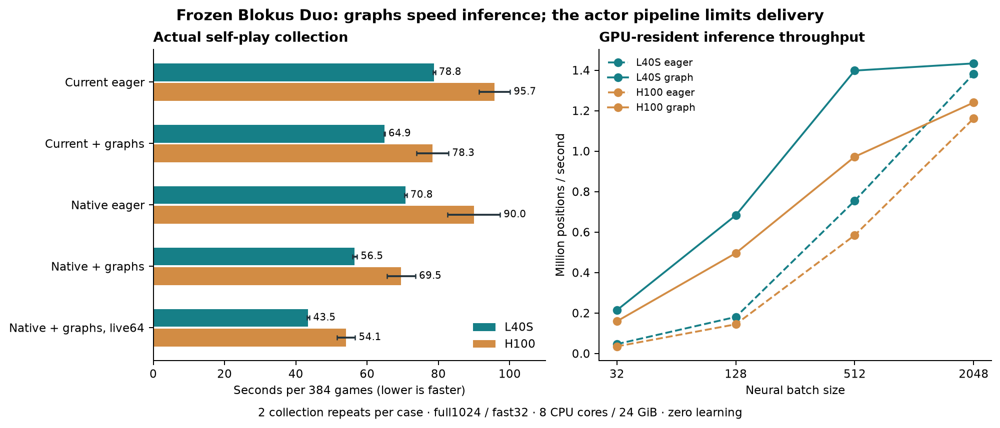
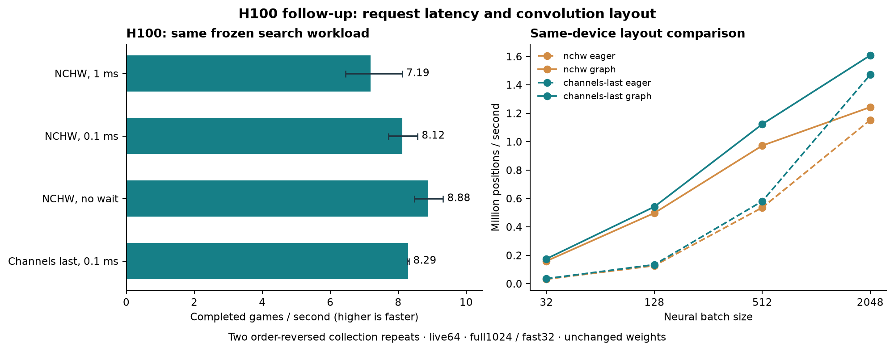

# Frozen CUDA Graph and H100 throughput evaluation

Dennis requested a Modal GPU evaluation on 28 October 2026, emphasizing useful
speed and the possibility of saturating an H100. Training remains stopped.
This is a frozen-weight performance study, not a playing-strength experiment.

## Verified results — 28 October 2026

CUDA Graphs improved actual collection on both GPUs. On L40S, graphs alone
raised throughput **1.21×**; native changes plus graphs and live64 raised it
**1.81×**, from 4.87 to 8.83 games/s. These are frozen self-play
collection measurements, not complete training-job or playing-strength gains.

| Configuration | L40S seconds / 384 | L40S games/s | H100 seconds / 384 | H100 games/s |
|---|---:|---:|---:|---:|
| current-eager | 78.80 | 4.87 | 95.74 | 4.01 |
| current-graph | 64.89 | 5.92 | 78.33 | 4.90 |
| native-eager | 70.79 | 5.42 | 89.95 | 4.27 |
| native-graph | 56.51 | 6.79 | 69.54 | 5.52 |
| native-graph-wide | 43.47 | 8.83 | 54.13 | 7.09 |



Bars show two means; whiskers show the observed repeat range, not confidence
intervals. H100 repetition 2 ran on a replacement container after preemption.

### Same-device H100 batching/layout diagnostic

| Layout / batching delay | Seconds / 384 | Games/s | Simulations/s | GPU busy | CPU cores | Estimated $ / 1,000 games |
|---|---:|---:|---:|---:|---:|---:|
| nchw, 1.0 ms | 53.41 | 7.19 | 57,569 | 12.3% | 4.22/8 | $0.175 |
| nchw, 0.1 ms | 47.27 | 8.12 | 65,039 | 14.3% | 4.62/8 | $0.155 |
| nchw, 0.0 ms | 43.24 | 8.88 | 71,109 | 21.3% | 4.93/8 | $0.141 |
| channels_last, 0.1 ms | 46.31 | 8.29 | 66,399 | 13.5% | 4.64/8 | $0.151 |

Best tested H100 setting: **nchw-0.0**, 1.24× the same-device 1 ms NCHW baseline.
There were only two collection repetitions. The 1 ms baseline ranged from
47.30 to 59.52 seconds, so the gain's magnitude is uncertain.
No wait won within both repetitions. Channels-last versus NCHW at 0.1 ms
changed direction between repetitions; its small mean collection gain is
mixed evidence, despite the clear bulk-inference improvement. L40S was not
tested at zero wait or channels-last, so this is not a comparison of each
GPU's globally best configuration.
This is a finite diagnostic; it does not establish the globally optimal delay,
live-game count or hardware configuration. Layout can alter bf16 rounding and
search trajectories, so all actual simulation counts accompany game throughput.



### GPU activity, memory and the remaining bottleneck

| Measured collection configuration | GPU busy | CPU cores | Peak host GiB / 24 | Peak VRAM MiB | Physical / requested neural rows |
|---|---:|---:|---:|---:|---:|
| L40S current-eager | 8.2% | 3.48/8 | 10.38 | 627 | 1.000× |
| L40S native-graph-wide | 11.1% | 4.17/8 | 11.54 | 1881 | 1.172× |
| H100 current-eager | 9.8% | 3.55/8 | 10.23 | 745 | 1.000× |
| H100 native-graph-wide | 11.3% | 4.39/8 | 11.24 | 2033 | 1.190× |

| GPU / layout | Graph positions/s, batch128 | Graph positions/s, batch2048 |
|---|---:|---:|
| L40S NCHW, comparison stage | 683,359 | 1,433,762 |
| H100 NCHW, comparison stage | 496,284 | 1,240,285 |
| H100 nchw, same-device final stage | 497,990 | 1,243,364 |
| H100 channels-last, same-device final stage | 542,289 | 1,608,102 |

These GPU-resident tests exclude request packing, transfer and search. In
collection the inference service includes packing/copy/response work and each
search worker waits for its result. Low aggregate CPU use does not prove the
CPU-side search work is cheap: dependencies and handoffs leave cores idle.
The gap between bulk inference and delivered collection supports focusing on
concurrency and handoff overhead. It does not identify a single kernel or
establish peak FLOP/bandwidth saturation. GPU and host memory capacity were
not exhausted in the successful comparisons.
The sustained batch2048 graph runs reached 100% GPU busy time on both GPUs;
that establishes continuous kernel activity, not peak hardware utilization.
No wait also reduced mean batch size from about 147 to 87 and raised padded
neural rows from 1.189× to 1.341× requested rows.
Thus its higher GPU busy time includes less efficient small/padded batches,
as well as the useful increase in completed search work.

### Audit, actual work and costs

All 10 cases per primary GPU passed the saved-artifact audit: 3,840 measured
games plus 120 warmups each. The final probe ran 8 cases, each 384 measured
games plus 12 warmups. There were **zero gradient updates**, no new model
selection and no opponent benchmarks. Runtime tables exclude setup/warmup;
provider costs include paid setup, the failed loader attempt and preemption.

| Stage | Measured simulations | Requested neural positions | Physical neural rows, including padding |
|---|---:|---:|---:|
| L40S | 30,887,936 | 24,128,331 | 28,230,123 |
| H100 | 30,744,192 | 24,010,805 | 28,251,960 |
| H100 final probe | 24,597,760 | 19,339,835 | 24,349,192 |

| Phase app | Actual provider metering USD |
|---|---:|
| `ap-Chtgg9VvtUYBSNzcOXV1az` | $0.62984390 |
| `ap-mbrn9DixNlWr92KRii382x` | $0.62029886 |
| `ap-pcbKy7PHqSUn8AsUyZG4xD` | $0.75591184 |
| `ap-yGUCk4BBAXkUA1RrJmyJze` | $0.19414255 |
| `ap-zKZ2oNYB79MtAJHIz0VFPN` | $0.83891622 |
| **Total** | **$3.03911337** |

This is CLI provider metering at the final snapshot, not an invoice. The
original shared reservation was $4.19642 under a $5 ceiling; unused stopped
reservations were settled before the bounded final probe. The $50 credit
reserve remains protected. Estimated dollars per 1,000 games use collection
time and the GPU+8-core+24-GiB rate, excluding setup and failures.

The native implementation passed exact ordered-state and arbitrary-prior
root-statistic comparisons. GPU checks covered seven batch sizes, padded
capture equality, unpadded probabilities/values and output lifetime. These
checks recorded a maximum capture error of 0; maximum unpadded errors were 0.00052805804 for probabilities and 0.00390625 for values.
Channels-last retained identical weights. Maximum tested layout errors were
0 for probabilities and 0 for values.
The two GPU fixtures have exactly identical arrays.
All four final settings recorded identical measured simulation counts within
each repetition. The recorded-training-data digest differed for zero-wait
repetition 4; the other three settings matched there, and all four matched
in repetition 3. Numerical fixture checks are not proof of bitwise identity
for every collected position; no playing-strength equivalence was tested.

Audits verify source/payload/native hashes, original completed-case bytes,
all counters, physical padding, stopped apps and preserved certified/Blokus
checkpoints. They do not replay full game action traces: this performance
study saved collection counters and record digests, not game traces.

Reproduction after downloading into unused directories:

```sh
.venv/bin/python cloud/report_cuda_benchmark.py --run <stage> --apps <stopped.json> --app-id <id> --billing <report.json> --gpu <l40s|h100>
.venv/bin/python cloud/report_cuda_latency.py --run <final-probe> --apps <stopped.json> --app-id <id> --billing <report.json>
MPLCONFIGDIR=.cache/matplotlib .venv/bin/python cloud/plot_cuda_benchmark.py
.venv/bin/python cloud/write_cuda_results.py
```

Full verified counters and telemetry are in `runs/cuda-graphs-l40s-verified.json`,
`runs/cuda-graphs-h100-verified.json` and `runs/cuda-latency-verified.json`.
The final local archive is `.backups/cuda-graphs-complete-20261028.tar.gz`;
its `.sha256.json` sidecar lists the archive hash and every read-back-verified
member hash. CPU staging/fixture contracts passed all three targeted tests.

Training remains stopped. The next implementation target is a persistent
native actor/inference pipeline with more independent games and fewer
Python queue/packing handoffs, measuring useful simulations/s and cost.
Graph/layout integration into training must also verify behavior across
weight updates; this study evaluated a frozen model only. No further paid
experiment or training is launched automatically.
For the current small network, L40S remains the better-value measured choice:
native+graphs/live64 cost an estimated $0.079 per 1,000 collected games versus $0.141 for the best H100 diagnostic setting.
This collection-only estimate excludes setup, and L40S has not received the
same final delay/layout tuning. Do not multiply gains across different
instances/repetitions into an asserted complete-training speedup.

## Prespecified execution

- Serial L40S, then strict H100 (`H100!`), each one 30-minute hard-limit call,
  eight capped CPU cores, 24 GiB RAM, retries0 and max1container. No duplicates
  or automatic study repeats. H100 starts only after verified, stopped L40S.
- Combined cap **$5**; combined reservation **$4.19642**, including $0.50 image
  startup/build allowance. CLI rates: L40S total $2.5204/hour, H100 total
  $4.5204/hour with these CPU/RAM limits. Existing $130 credit authorization;
  retain $50 reserve. No top-ups, plan changes or training launch.
- Immutable base image `im-BnyLYweX6vlwu6iCpDnqrC`; source-only overlay and
  separately compiled native prototype. No additional model/replay upload.
  Private Volume `blokus-deep-selfplay-20261026`, profile `linuxfan2718`.
- Frozen selected parent SHA256
  `95569be7c179180c12681255dbcee9884f465e713f418e958a508907beb4d512`.
  Its existing latest replay-state SHA256 is
  `df74afa8bf699eb63f9dcf4d32cd13530e7b276f66c63ddd28368049edf75911`.
  Both remain unchanged. A deterministic 2,048-position input fixture is generated
  inside the private Volume from the existing replay, seed1069.

## Comparisons

First, verify the isolated Linux native implementation against the image's
original extension on 32 random games and search roots with arbitrary neural
priors/values. Compare all ordered decisions and complete root statistics.
This supplements the earlier local saved-trace tests.

CUDA Graphs capture network, legal-logit gather, softmax and clamped values.
Pinned host buffers and device tensors persist for each shape. Transfers are
ordered before graph replay; host output is read only after stream completion,
then copied into caller-owned arrays. Batch buckets 8/16/32/64/128/256 and legal
width buckets 64/256/1024/2048 bound shape variety. Unsupported shapes use the
original eager evaluator with explicit fallback accounting. No neural cache.
Record requested versus padded physical neural positions separately.

Correctness compares eager and captured outputs at identical padded shapes
(maximum absolute error <=1e-6) and ordinary unpadded bf16 inference (probability
error <=0.002, value error <=0.02). Report actual maxima, not just pass/fail.
Check normalization, finite outputs, changed inputs and output lifetime.
Padding/batching can change CUDA floating-point trajectories; bitwise search
identity across eager/graph collection is not presumed.

Microbenchmark: real frozen inputs already on GPU, batches32/128/512/2048,
eager versus captured execution, three alternating-order repetitions. Calibrate
iteration count to roughly 0.7 seconds, cap20,000 calls, and report wall/CUDA-event
time, actual iterations and positions/s. A separate ten-second sustained run at
batch2048 measures each mode with sufficient telemetry coverage. This is an
inference-service ceiling, not achieved self-play throughput.

End-to-end cases, twice in reversed order on repetition2:

1. Current engine, eager inference.
2. Current engine, CUDA Graphs.
3. Corner-index/PUCT prototype, eager inference.
4. Corner-index/PUCT prototype, CUDA Graphs.
5. Native prototype + graphs, 64 rather than 32 live games per worker.

Each case has 12 warmup games and **384 measured games**, six workers, full1024
on recorded20% of roots, fast32 on unrecorded80%, inference256/leaf8, seed1069,
CUDA bf16/TF32. Exact same weights and budgets; no gradients, model promotion or
new Pentobi games. There are 3,840 measured games plus120 warmups per GPU.
Record actual games, roots, simulations, requested/padded neural work, timing,
source/native/model hashes and record digests. Changed live-game grouping can
change execution/trajectories; actual work must accompany throughput.

## Measurements and decision

Sample GPU busy-time indicator, memory-controller busy, VRAM, power and clocks;
also cgroup CPU usage and host RAM. Join samples with explicit phase markers.
Report game/s, simulations/s, neural positions/s, end-to-end time, cold capture
overhead, GPU activity and provider cost per fixed workload. NVIDIA GPU busy
time is not percent of peak FLOPs or proof of Tensor Core saturation.

The primary decision is whether graphs increase actual collection throughput;
compare current-graph with current-eager and native-graph with native-eager.
Separate the native and concurrency effects. Compare H100/L40S throughput and
cost efficiency at matched settings. High GPU-only activity with low collection
activity identifies supply/coordination limits; do not inflate utilization with
padding and call it useful speed. These finite tests cannot establish a global
hardware maximum.

Execution ledgers and exact payload hashes were saved before launch. Preserve
all failures and atomic results; download only after each finished marker and
stopped app with zero tasks. Audit all records, costs and preserved states;
back up locally with member hashes, commit validated code/docs without pushing,
then report results. No follow-on training is part of this authorization.

References: [PyTorch CUDA Graph semantics](https://docs.pytorch.org/docs/2.14/notes/cuda.html),
[PyTorch pinned transfer guidance](https://docs.pytorch.org/tutorials/intermediate/pinmem_nonblock.html),
[Modal GPU selection](https://modal.com/docs/guide/gpu).

## Corrected loader attempt

The first L40S app `ap-yGUCk4BBAXkUA1RrJmyJze` passed the native and graph
numerical checks and completed the inference microbenchmarks, then its first
collection subprocess hit the 160-second limit. Diagnosis found a benchmark
loader error: indexing lazy `NpzFile` members once per row repeatedly decompressed
whole arrays and retained duplicate backing arrays. The fix materializes each
array once and returns shared views; a regression test checks their shared
backing storage. Scientific settings, graph code, native code and weights stay
the same. The original protocol/source/payload/ledger are retained unchanged.

The original app is stopped with zero tasks, metered **$0.19414255**. Its complete
microbenchmarks, failure and telemetry are preserved in
`runs/duo-cuda-l40s-interrupted-20261028T043915Z/`. This is included in the same
$4.19642 reservation/$5 cap: $3.69642 for the two remaining GPU hard limits,
$0.25 allowance for the stopped attempt and $0.25 for image build/startup.
The corrected run is `duo-cuda-graphs-1069-r1`, with separate `-r1` ledgers and
payload archive. It repeats the comparisons with the corrected loader; initial
microbenchmarks remain diagnostic evidence, not mixed into its repetitions.

## Finite follow-up specified after L40S results

The corrected L40S comparison completed and verified: 78.80 seconds per 384 games
for current/eager, versus 43.47 for native+graphs/live64, but GPU busy time only
about 11%, versus 100% in sustained GPU-only inference. Aggregate CPU use in that
best case was 4.17 of 8 cores. The source still permits up to 1 ms of request
coalescing per small inference batch.

After both original GPU stages stop and verify, one final **strict H100** call
may test delay1/0.1/0ms at unchanged live64/full1024/fast32 settings, repeats3/4
in reversed order. Based on the H100's unexpectedly slower initial NCHW
microbenchmark, it also checks channels-last layout at0.1ms: identical weights,
explicit output comparisons against NCHW, and inclusion only if the same
probability/value tolerances pass. GPU-only NCHW and channels-last tests run on
that same final device; layout and coalescing effects remain separate.

This is a single finite follow-up, not an adaptive training or opponent study.
It has a780-second hard limit,8 capped cores/24GiB, retries0/max1container,
and one-shot ledger. Settle all stopped attempts to their actual provider
costs before reserving another870 seconds at the current H100 rate plus$0.05
startup allowance. The launcher refuses if **all prior apps' actual costs plus
the new reservation exceed the original $5 cap**, or the $50 reserve would be
touched. No larger GPU run, new model or training follows automatically.

## H100 preemption and remaining-case recovery

Modal preempted `ap-pcbKy7PHqSUn8AsUyZG4xD` after all five repetition-1 cases
had committed. Its infrastructure restart hit the exclusive directory guard
and stopped; no completed case was replayed. The original app stopped at
01:10:48 EDT on 28 October, with $0.75591184 metered in the settled snapshot.
Its complete committed directory and provider log are preserved in
`runs/cuda-graphs-h100-preempted-20261028T051312Z/` and a member-verified backup
`.backups/cuda-graphs-h100-preempted-20261028.tar.gz`.

The manual recovery `ap-mbrn9DixNlWr92KRii382x` uses the same immutable image,
weights, fixture and benchmark source and runs **only the five missing
repetition-2 cases**, with a 900-second hard limit. Its $1.26811 reservation
plus the stopped H100's actual cost fits the original H100 allocation. An
exclusive recovery directory blocks another infrastructure replay. The old
execution, failure and completed case bytes remain unchanged; timestamps and
telemetry from the original and replacement containers are audited separately.
This means the two H100 repetitions span two hardware instances. Original
failed/preempted attempts remain included in the phase cost.

## What utilization can establish

The reported GPU utilization is the fraction of sampled time with a kernel
running, and memory utilization is an activity-time indicator. Neither measures
the percentage of peak FLOPs, Tensor Core throughput or peak memory bandwidth.
See [NVIDIA's nvidia-smi definitions](https://docs.nvidia.com/deploy/nvidia-smi/index.html).
We therefore distinguish a continuously busy inference service from a
fully utilized H100. No Nsight hardware-counter profile was collected.

CUDA Graphs reduce host launch work by replaying a captured operation sequence;
they do not remove search dependencies or automatically supply bigger batches.
The implementation follows [PyTorch's capture and memory-lifetime requirements](https://docs.pytorch.org/docs/2.14/notes/cuda.html).
Channels-last is a separate convolution layout optimization, recommended with
mixed precision in [PyTorch's tuning guide](https://docs.pytorch.org/tutorials/recipes/recipes/tuning_guide.html).
Its measured value here must come from the same-device diagnostic, rather than
assuming an H100 or a layout change is faster.
