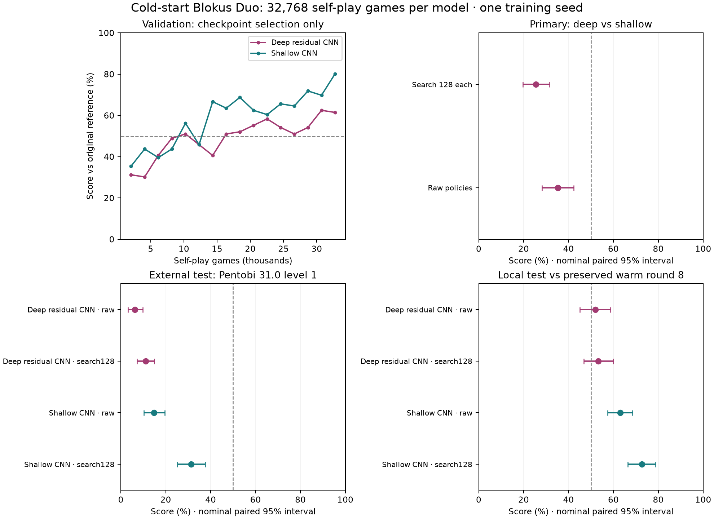

# Cold-start Blokus Duo study — 26 October 2026

**The deeper network did not help in this bounded study.** The shallow CNN
learned entirely from self-play and was substantially stronger than the deep
model and the original reference. Pentobi level 1 still beats our agents.

The prespecified primary comparison scored **25.50%** for
deep search128 against shallow search128 (paired 95% interval
19.75%–31.50%).
The success criterion was a lower bound above 50%; it failed. This is evidence
about these two trained agents at this budget, not a general verdict on deep CNNs.



## What was trained

Both models began with random weights and played both seats. Rust supplied
legal moves and terminal win/draw/loss. Search supplied policy visit targets;
the final game outcome supplied value targets. No heuristic, Pentobi or other
expert supplied training labels. During training, the original reference was
used for checkpoint selection, never for training targets.

Both used 128 rounds × 256 games, six CPU search workers and a shared L40S
inference server. On 80% of moves, search used 32 simulations; on 20%, 256 with
root noise. Only the latter positions entered replay. The fixed settings were
100,000 replay positions, about 3 gradient examples per new recorded position,
minibatch 256, AdamW learning rate 0.001, clipped gradients and bf16 GPU autocast.

Deep: 10 residual blocks × 64 channels, GroupNorm and inventory FiLM. Shallow:
four 32-channel convolution layers. Depth, width, normalization and inventory
conditioning design changed together, along with coordinate inputs and tanh
versus linear value outputs. This does not isolate a causal depth effect.

| Actual full training budget | Deep | Shallow |
| --- | ---: | ---: |
| Parameters | 986,205 | 52,978 |
| Games | 32,768 | 32,768 |
| Recorded full-search positions | 223,537 | 225,539 |
| Search simulations | 85,781,504 | 86,621,152 |
| Neural positions evaluated | 73,065,902 | 74,740,890 |
| Gradient steps | 2,688 | 2,702 |
| Gradient examples | 688,128 | 691,712 |
| Selected round (validation) | 120 | 128 |
| Training elapsed, including checkpoint/commit overhead | 2.099h | 1.723h |
| Mean shared inference batch | 99.7 | 90.2 |

Equal games and collection/training rules do not imply equal wall time or
identical neural/gradient counts; game trajectories differ. The test uses
selected checkpoints, not necessarily the final weights. All checkpoints
are preserved, including the weaker deep network.

## Held-out cloud results

Each row contains 200 games: 100 four-ply random opening positions, each
played with seats swapped. Test seed 2569000 was separate from the 24-pair
validation seed 2563000 used every 8 rounds for checkpoint selection. Frozen
checkpoint hashes were recorded before test openings were generated.

Score is wins plus half draws. Intervals resample whole opening pairs
10,000 times. They are nominal 95%, without correction for the many secondary
comparisons, and do not include uncertainty across independent training runs.

| Agent vs opponent | W/D/L | Score | Paired 95% interval |
| --- | ---: | ---: | ---: |
| Deep search128 vs shallow search128 (primary) | 47/8/145 | 25.50% | 19.75%–31.50% |
| Deep raw vs shallow raw | 66/9/125 | 35.25% | 28.25%–42.25% |
| Deep residual CNN raw vs original raw | 94/9/97 | 49.25% | 42.75%–55.75% |
| Deep residual CNN search128 vs original search128 | 114/13/73 | 60.25% | 53.50%–66.75% |
| Deep residual CNN raw vs Pentobi 31.0 level 1 | 12/1/187 | 6.25% | 3.25%–9.75% |
| Deep residual CNN search128 vs Pentobi 31.0 level 1 | 21/2/177 | 11.00% | 7.25%–15.00% |
| Shallow CNN raw vs original raw | 115/7/78 | 59.25% | 53.50%–65.00% |
| Shallow CNN search128 vs original search128 | 153/7/40 | 78.25% | 73.25%–83.25% |
| Shallow CNN raw vs Pentobi 31.0 level 1 | 27/5/168 | 14.75% | 10.25%–19.50% |
| Shallow CNN search128 vs Pentobi 31.0 level 1 | 58/9/133 | 31.25% | 25.25%–37.50% |

Searched neural-vs-neural rows give both sides 128 simulations/move.
Pentobi uses its own level 1 search budget, one thread, no book/resignation;
this is an outside playing-strength benchmark, not matched wall-clock or
search-node compute. Its pinned 31.0 engine independently checks every game
and final margin against Rust. Pentobi remained evaluation-only. Per-case JSON
stores actual search/neural counters; raw inference and Pentobi node counts
were not collected. Rust verifies the requested simulation count at every root.

## Local comparisons and learning checks

Same frozen selected weights and opening book, evaluated locally in CPU
float32, using 10-pair atomic chunks. Cloud uses GPU bf16 autocast; precision
and inference grouping can change decisions. The old warm-round8 checkpoint
was copied and hashed locally and was never uploaded for this study.

| Agent vs opponent | W/D/L | Score | Paired 95% interval |
| --- | ---: | ---: | ---: |
| Deep residual CNN raw vs its untrained initial network | 191/3/6 | 96.25% | 93.50%–98.50% |
| Deep residual CNN raw vs largest-piece heuristic | 133/3/64 | 67.25% | 60.25%–74.00% |
| Deep residual CNN raw vs warm-round8 raw | 99/10/91 | 52.00% | 45.00%–58.75% |
| Deep residual CNN search128 vs warm-round8 search128 | 102/9/89 | 53.25% | 46.75%–60.00% |
| Shallow CNN raw vs its untrained initial network | 199/0/1 | 99.50% | 98.50%–100.00% |
| Shallow CNN raw vs largest-piece heuristic | 157/6/37 | 80.00% | 75.00%–84.75% |
| Shallow CNN raw vs warm-round8 raw | 123/6/71 | 63.00% | 57.50%–68.50% |
| Shallow CNN search128 vs warm-round8 search128 | 139/13/48 | 72.75% | 66.50%–78.75% |

An untrained neural network is not a uniform-random player. These checks
describe learning and baseline strength; they did not select checkpoints.
Old reports used different opening seeds and must not be treated as direct
head-to-head rankings against today's results.

## Normal starting board: descriptive only

Exactly two deterministic seat-swapped games per case, with no population CI.

| Agent vs original reference, same search budget | W/D/L |
| --- | ---: |
| Deep residual CNN, 0 simulations | 1/0/1 |
| Deep residual CNN, 128 simulations | 1/0/1 |
| Shallow CNN, 0 simulations | 1/0/1 |
| Shallow CNN, 128 simulations | 1/0/1 |

## Hardware, costs and recovery

The main call finished in 4.088 hours and
the app is stopped with zero tasks. No training retry was necessary.
Provider per-app metered snapshot: main study **$10.3249**;
L4 screen $0.0376; L40S screen $0.0364;
phase app total **$10.3989**. This is metered usage covered by existing
credits, distinct from $18.45155 conservative reservations and the $35 phase
ceiling. Volume storage/download accounting can arrive later. Resource rates
included the GPU, eight capped CPU cores and 24 GiB capped RAM.

Telemetry sampled about every 5 seconds: mean GPU busy 12.2%,
median 7.0%, peak GPU memory in use
1.59 GiB of 45.0 GiB.
These whole-call samples include collection, training, checkpoint IO and
evaluation. GPU memory capacity use and GPU compute utilization are different
measurements; filling memory is not the objective.

The first artifact download failed because the Modal CLI treated a nonexistent
destination as a file while recursively creating a directory. Retrying into
that empty directory succeeded, without restarting paid compute. The final
client log-tail timeout occurred after the remote call returned; finished.json,
all test artifacts and provider stopped state confirm completion. Neither was
a training failure. Frozen hashes and earlier certified model hashes verified.

All 68 Python tests passed, including a real interrupted/resumed local evaluation
that preserved games, seed offsets and paired intervals and rejected changed
settings. Existing rules were unchanged. Cloud artifacts have a local SHA256
manifest and compressed backup; local results are backed up after completion.

## Interpretation and next hypothesis

Batched self-play can cold-start a useful Blokus Duo policy without an outside
teacher. Search adds substantial strength. The deeper architecture failed this
comparison despite equal game budgets; its cause is unproven. More parameters
alone did not provide a better agent at this training ratio and duration.

The next useful experiment is a small prespecified multi-seed replication of
the shallow setup, with fresh validation/test openings and a fixed compute
budget, before tuning architecture or training against Pentobi. A separate
training-ratio ablation could test whether the deep model needs more updates
per collected position. Neither experiment has been launched. This bounded
study stops here; one seed cannot establish SOTA or superhuman strength.

## Reproduction and artifacts

Methods: [deep-self-play.md](deep-self-play.md). Rolling audit:
[deep-status.md](deep-status.md). Architecture explanation:
[alphablokus-explanation.md](alphablokus-explanation.md).

```sh
.venv-modal/bin/modal run --detach --profile linuxfan2718 cloud/modal_deep.py --stage study --gpu l40s --run-name duo-deep-study-764
.venv/bin/python -m blokus_rl.duo_deep_local --run runs/duo-deep-study-764-download-20261026T0634/duo-deep-study-764 --out runs/duo-deep-local-764 --threads 1
.venv/bin/python -m blokus_rl.duo_deep_report --run runs/duo-deep-study-764-download-20261026T0634/duo-deep-study-764 --local runs/duo-deep-local-764 --billing runs/modal-deep-final-billing-full-days-20261026T0704.json --out docs/deep-results.md
```

The cloud command is the original command, not an instruction to restart a
finished run. Resume local evaluation only explicitly with --resume and the
same frozen protocol after checking that no duplicate is active.

- Cloud artifact directory: `runs/duo-deep-study-764-download-20261026T0634/duo-deep-study-764`.
- Local comparison directory: `runs/duo-deep-local-764`.
- Provider snapshot: `runs/modal-deep-final-billing-full-days-20261026T0704.json`.
- Original training source commit: `6963505b5a96318dcd136368388d7cac1d886e72`.
- Private Volume: `blokus-deep-selfplay-20261026`; no new model was published.

Frozen selected checkpoint SHA256:

- Deep residual CNN: `f0d86f5c1f39c9492b90de02b0ed5b30ff8d964a3363655eb01ee7dda5b20382`.
- Shallow CNN: `0ba92438d27fb72f23364547ba3717729464ace9af23a414cfdff1cbd3298f86`.
