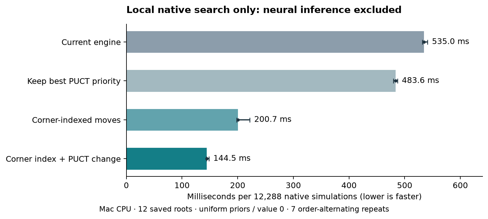

# Further Duo speed ideas — local evaluation, 28 October 2026

**The best new candidate is corner-indexed legal move generation, followed by
a small PUCT loop optimization.** Together they reduced time in an isolated
native search benchmark by 73%, a 3.70× throughput increase. This excludes neural
inference, Python/IPC and persistence, so it is not a whole-training multiplier.
The production engine and training defaults have not been changed by this
evaluation. Training remains stopped; no Modal job or new opponent test was run.

## Native search prototypes

The current engine scans all 13,729 valid placements when generating legal
actions. The prototype precomputes placements touching each board cell, visits
only those touching a playable corner/start, deduplicates them with a small
bitset, applies the unchanged legality checks, and sorts the result to retain
the original action ordering. This is an index of fixed geometry, not a
learned-position cache. It requires 61,772 index entries (494,176 bytes of
logical 64-bit entry data, plus vector capacity/metadata) and 2,232 bytes of
temporary seen bits per call.

The PUCT change keeps the best priority value while scanning actions. The
original loop recomputes the current best action's score at each comparison.
Keeping it avoids repeated arithmetic while retaining strict-greater tie
handling and the same f32 operations for each candidate.

Seven repetitions alternated variant order. The move-generation workload
contained **7,236 saved positions**, including terminal positions, from all
**200 already completed level-4 game traces**, with 650 forced-pass moves. The
native search workload used 12 roots (plies 0/8/16/24 of the first three saved
games), exactly 1,024 simulations per root and leaf batch 8: **12,288 simulations
per variant/repetition**, uniform priors and zero leaf values. These searches
have no neural service or root noise.

| Prototype | Legal-list median ms | Native search median ms | Native search throughput vs current |
| --- | ---: | ---: | ---: |
| Current engine | 258.05 | 534.97 | 1.00× |
| Keep best PUCT priority | 260.67 | 483.63 | 1.11× |
| Corner index | 106.45 | 200.72 | 2.67× |
| Corner index + PUCT change | 106.44 | 144.48 | **3.70×** |



Current native search ranged 531.60–541.08 ms; the combined prototype ranged
143.83–148.26 ms. Legal-list generation alone was 2.42× faster. These gains
share a workload and must not be multiplied together.

Correctness checks ran separately from timing. Every fixture's complete ordered
legal list matched the original scan, including pass and terminal behavior.
Every requested search leaf also matched the scan oracle, and **all complete
root statistics** (actions, priors, visits, means, node/simulation counts) matched
across all four implementations. Full root-stat file SHA256:
`68119ebcca6a2da725dd30a8c2b08fd152079d977c56330786e33c8c8adbb843`.
The optimized engines were isolated source copies under `runs/`; the installed
Python native extension and production Rust files were untouched.

This is strong prototype evidence, with limits: one Mac CPU/compiler, a small
12-root uniform-prior search workload, and existing level-4 positions rather
than fresh neural self-play. Before integration, exercise arbitrary priors,
random legal histories and complete neural collection/recovery. A frozen L40S
collection benchmark at both full1024 and full2048 should establish the actual
job-level benefit before another training launch.

## Inference handoff prototypes

A separate local CPU profile used the preserved 52,978-parameter CNN, seed1068,
eight frozen self-play games, full128/fast32, four live games, one process and
one Torch CPU thread. It completed 14,240 simulations and 12,264 neural positions
in 3.59 profiled seconds. Neural calls took 2.76 seconds; the Rust request API
took about 0.61 seconds in the initial equivalent profiling pass. This is a
different workload/hardware from the six-worker L40S service and cannot supply
its bottleneck fractions.

The first 2,048 neural leaves were saved for reproducible component tests.
Seven order-alternating repetitions followed warmups. Packing used 400 calls
per repetition; response assembly 700. The sample is biased toward early game
positions, with maximum 828 legal actions in the tested batches.

| Host-side component | Current median µs | Prototype median µs | Observation |
| --- | ---: | ---: | --- |
| Pack 32 request rows | 37.58 | 24.57 | 1.53× faster using whole request blocks |
| Pack 128 request rows | 135.83 | 91.48 | 1.48× faster using four 32-row blocks |
| Return 128 policy rows in four replies | 97.65 | 41.66 | 2.34× faster avoiding per-row copies/repacking |
| Simply reuse allocations, 128 rows | 135.83 | 142.10 | Slightly slower; not recommended alone |

All compared observations, indices, masks and reply arrays matched exactly.
The bulk pack prototype copies already-populated wide/strided request buffers
instead of turning each leaf back into a Python dictionary and rebuilding it
row by row. The reply prototype copies batched slices into their final output
arrays, retaining padding and values, instead of copy → Python list → repad →
copy. These are **component timings**, excluding real IPC and device transfer.
The absolute savings are tens of microseconds, so the overall gain could be
small. Reused shared/pinned/device buffers would still need response-lifetime,
stream-synchronization and cleanup tests in a production implementation.

The Rust boundary still creates six candidate-geometry integers for every
neural leaf, even though spatial inference now consumes policy indices.
Those geometry bytes were 58.8% of the encoded bytes in the first-2,048-leaf
sample. A compact indexed-leaf API could remove that work and transfer; this is
a **byte-count observation, not a measured speedup**. Retain the legacy API and
root candidates for callers that still need them.

## Ideas with no demonstrated local win

At batch32, median CPU inference was 7.181 ms with `no_grad`, 7.199 ms with
`inference_mode`, and 7.247 ms with channels-last weights plus `inference_mode`.
Outputs matched exactly here. These differences do not establish a useful
improvement. They do not rule out a CUDA-specific layout benefit: PyTorch's
[tuning guide](https://docs.pytorch.org/tutorials/recipes/recipes/tuning_guide.html)
discusses channels-last with AMP/Tensor Cores.

For the same 256 CPU neural inputs, batching in groups of 8/32/64/128 took
45.97/58.20/54.57/54.57 ms median over five repetitions. Outputs agreed within
2e-6 absolute plus 2e-5 relative tolerance. Larger batches were not automatically
faster on this CPU; this does not determine the L40S optimum. The GPU service's
previous measured mean batch was about 113, below its 256 maximum.

## Next steps ranked

1. **Integrate and validate the corner index and PUCT loop change.** This has the
   strongest new measured evidence. Preserve canonical ordering, forced pass,
   terminal handling and exact simulation accounting. Then measure frozen
   neural collection end to end; do not claim the 3.70× native result for it.
2. **Keep inference requests/replies as blocks.** Combine the bulk input path,
   direct reply slices and a compact native indexed-leaf API. The component wins
   are real locally; fewer Python objects and boundary copies are the point.
3. **Test fixed-shape compiled/captured GPU inference.** The small CNN, low
   observed GPU busy time and many small calls make this a plausible fit.
   [PyTorch documents `reduce-overhead`](https://docs.pytorch.org/docs/2.14/generated/torch.compile.html)
   as using CUDA Graphs for small batches, with applicability and memory limits.
   Try a few batch-size buckets, measure padding/compilation warmup as well as
   steady state, and validate probabilities/values and search counters. No CUDA
   Graph benefit was measured on this CPU-only machine.
4. **Tune work in flight after those changes.** Compare live-game count and
   batching delay at fixed games/search budgets while measuring latency tails,
   RAM and actual neural work. More workers alone may increase overhead; changing
   worker count currently also changes per-worker seed assignment, which must
   be handled explicitly for a fair comparison.

Persistent pinned buffers and overlap belong with steps 2–3, not a per-batch
`.pin_memory()` call. PyTorch's [transfer tutorial](https://docs.pytorch.org/tutorials/intermediate/pinmem_nonblock.html)
shows that pinning immediately before each copy can be slower. A nonblocking
copy followed by an immediate NumPy read still needs synchronization; avoid
unsafe buffer reuse.

Lower priorities: a bigger neural cache (the previous real GPU cache test was
slower), quantization or a larger GPU before launch/host overhead is measured,
and gradient-step tuning (under 0.2% of the original timed rounds). Subtree reuse
changes effective search budgets/targets and requires its own scientific
comparison. Less frequent commits or asynchronous snapshots change recovery
guarantees; keep them separate from the proven lossless checkpoint packing.

## Reproduction and preserved state

```sh
.venv/bin/python cloud/benchmark_duo_pipeline.py --model runs/duo-continuation-final-20261026T2007/duo-continuation-865/frozen-strong1024.pt --out <unused-local-directory>
.venv/bin/python cloud/benchmark_duo_native.py --pairs runs/duo-level4-final-20261027T0210/duo-strong-search2048-level4-2604000/search-2048/level-04 --out <unused-local-directory>
```

Primary artifacts: `runs/duo-pipeline-evaluation-confirmed-20261028/` and
`runs/duo-native-evaluation-20261028/`. They contain all repetition timings,
sampled inputs, cProfile output, isolated Rust sources/binaries, fixture/source
hashes and the separate correctness audit. Initial pipeline measurements remain
in `runs/duo-pipeline-evaluation-20261028/`. The two pipeline passes executed the
same eight-game workload, each with one discarded warmup game; these are not
independent seeds or new learning. The Rust probe replays existing traces and
performs synthetic searches; no new Pentobi games were played.

Environment: macOS 26.6.2 arm64, Torch2.14.1 with one CPU thread, no CUDA;
Rust compiler version and source hashes are recorded in results. Frozen parent
SHA256 remains `95569be7c179180c12681255dbcee9884f465e713f418e958a508907beb4d512`.
Preserved certified/earlier models and both stopped atomic states were checked
unchanged. No gradients, model selection, training, uploads or paid compute
occurred. Additional provider cost: **$0**.

Source, scripts, reports and all new artifacts are in the verified backup
`.backups/duo-further-speedups-20261028.tar.gz`; every archived member was read
back and compared with its saved hash.
