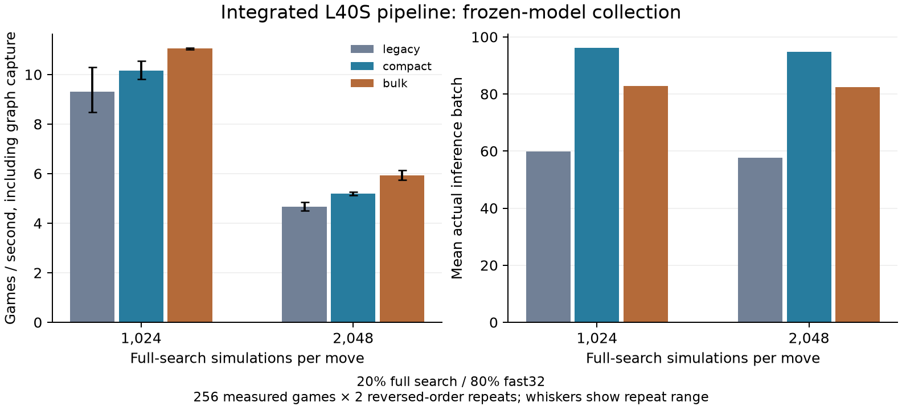

# Integrated speedups and fresh controlled run — 28 October 2026

**Morning status:** the requested overnight training run did **not** start overnight.
Local verification was complete at 08:08 EDT; GPU validation began successfully at
08:32 EDT. The full study is waiting for that validation to finish. All times here
are actual client dates in EDT; provider billing uses UTC.

## What changed

The production Rust engine now generates moves from indexed playable corners and
caches the best PUCT priority during selection. It retains the original placement
scan as a correctness oracle. Native search can emit policy indices directly,
removing repeated Python geometry conversion for search leaves.

Shared inference now supports whole-block staging, direct shared-memory replies,
and immediate batching of ready requests. CUDA Graph inference uses persistent
buffers and caller-owned outputs. Training rebuilds captures after optimizer
updates; frozen validation and playing search can also use graphs.

The neural cache remains disabled because the earlier real-workload test slowed
collection. Channels-last remains unselected because its collection improvement
was small and variable. The [earlier GPU study](cuda-graphs.md) favored L40S over
H100 for this small network and host-driven search. Saturating the H100 in a
GPU-resident microbenchmark did not saturate the complete game/search pipeline.

## Verification and runtime selection

- Rust tests passed, including exact indexed/scan move ordering through complete
  random games and forced passes.
- Original and integrated native extensions matched on 32 complete random games,
  964 positions, and 12 arbitrary-prior roots with 3,072 simulations per engine.
- All 96 Python tests passed, with seven existing warnings. The first sandboxed
  test lacked POSIX shared-memory permission; the full suite passed with access.
- GPU eager/captured outputs passed numerical checks on seven batch sizes before
  and after two discarded optimizer steps. Bulk and row graph outputs matched
  exactly, and output lifetime checks passed.
- Two unpromoted eight-game smoke branches matched model, AdamW, replay and
  CPU/CUDA/NumPy RNG state after interruption/recovery. This narrow single-worker
  result does not establish bitwise replay across asynchronous scheduling.
- The final training auditor also passed the preserved older control: 64 rounds,
  16,384 games, 1,364 gradients and 131,407,680 actual simulations.

Local evidence is under `runs/integrated-speedups-baseline-20261028/` and
`runs/integrated-auditor-historical-smoke.json`. The source-only GPU payload has
19 allowlisted files under `runs/integrated-payload-1070/`; its adjacent SHA256
manifest pins every file. No model, replay or unrelated file was uploaded.
Linux builds use the immutable base image's locked Rust manifests. The final
training audit requires the same native binary/build record as validation.

Frozen-model performance selection uses this prespecified comparison:

| Setting | Values |
|---|---|
| Transport modes | Legacy rows; compact rows + ready batching; compact bulk + ready batching |
| Full search | 1,024 and 2,048; fast 32 on the other 80% of roots |
| Repeats | Two, in reversed order |
| Work per case | 12 warm-up + 256 measured games |
| Parallelism | Six workers, 64 live games each, inference batch 256, leaf batch 8 |
| Inference | Integrated Rust, CUDA Graphs, bfloat16, TF32 allowed, zero wait |

Choose the lowest combined mean collection-plus-capture time among modes no
slower than legacy at either search budget; otherwise keep legacy transport.
The choice uses no learned checkpoint or game-strength test outcome. The twelve
cases contain 3,072 measured and 144 warm-up games, all with frozen weights.
The smoke branches add 16 discarded games and four discarded gradient steps,
separate from the two numerical optimizer probes. None count as study training.

Auditor: `cloud/report_integrated_validation.py`. Plot:
`cloud/plot_integrated_validation.py`. Passing writes
`runs/integrated-validation-verified.json`, which the training launcher requires.

## Fresh matched training study

Run: `duo-integrated-teacher-1070`. Both branches start from the preserved selected
round 112 parent CNN, with 52,978 parameters:

- Parent SHA256: `95569be7c179180c12681255dbcee9884f465e713f418e958a508907beb4d512`.
- Inherited round 128 state SHA256: `df74afa8bf699eb63f9dcf4d32cd13530e7b276f66c63ddd28368049edf75911`.

Both use the identical full 100,000-position replay from that later state and
fresh AdamW, because the later optimizer moments do not match selected weights.
The intentionally stopped earlier study and all its checkpoints stay preserved.

| Setting | Control | Teacher |
|---|---:|---:|
| Full search on recorded 20% of roots | 1,024 | 2,048 |
| Fast search on unrecorded 80% | 32 | 32 |
| Planned additional games | 64 rounds × 256 = 16,384 | 64 rounds × 256 = 16,384 |
| Soft training cap | 6,000 seconds | 10,000 seconds |

Fresh training seed is 1070. Both branches use the same selected runtime, six
workers × 64 live games, inference 256, leaf 8, zero wait, replay 100,000,
AdamW 0.001 / weight decay 0.0001, minibatch 256, training ratio 3, policy CE
weight 0.5 plus terminal WDL MSE, gradient clip 1, CUDA bfloat16 and TF32.
If caps bind, report actual unequal games, experience and compute.

Validation every 16 rounds uses 32 paired openings, seed 2607300, versus the
frozen parent at 512 simulations each. The unchanged parent is selectable at
50%: additional round 0, despite embedded update 112. Freeze selected files
before generating any held-out opening. Tests use 100 fresh four-ply opening
pairs, seed 2607900, both seats:

- Parent/control/teacher each against pinned Pentobi 31.0 Duo levels 3 and 4 at
  2,048 playing simulations: six cases, 1,200 games with full action traces.
- Teacher–control with search 2,048 and raw; teacher–parent raw; control–parent
  raw: 800 games with paired outcomes/counters, without action traces.

Finish all cases regardless of intermediate scores. No next level, extra search,
architecture change or further training is automatic.

Primary success is teacher-minus-parent paired Pentobi 4 score difference with a
nominal whole-opening 95% interval entirely above zero. The parent is retested on
the same book. Teacher-minus-control and head-to-head address benefit from extra
training search beyond more training. Absolute teacher Pentobi 4 score interval
entirely above 50% is a stretch goal. Crossing zero is inconclusive; below zero is
negative evidence. Report raw/search and validation/test separately.

One parent/training seed, inherited later replay, checkpoint selection, unequal
compute and multiple nominal intervals limit generalization. These results do
not establish human Elo, Classic/frontier strength or AlphaBlokus performance.

## Costs, failures and safeguards

Profile `linuxfan2718`; private Volume `blokus-deep-selfplay-20261026`.
Base image `im-g024WcGyhkVNjjImEuEZ1k`. Each function uses L40S, eight capped CPU
cores, 24 GiB RAM, retries 0 and at most one container. Validation hard limit is
1,200 seconds; study hard limit is 28,800 seconds (8 hours). Rate is $2.5204/hour.
Each reservation includes 90 seconds startup; validation also includes $0.15 build
allowance. The combined phase ceiling remains $23, preserving $50 of the original
$130 existing credits. Initial CLI metering was $46.03137374; the launcher floors
prior commitment conservatively at $46.25. No top-up or plan change.

| Attempt | Outcome |
|---|---|
| `ap-KwsyrmMhvZpLz8Xy9P9LSy` | Guard counted its own app; no GPU function submitted. Fixed by excluding the submitting app. |
| `ap-tUfMbBe5gfBIYvlmZ3wD25` | Runner import failed before study code. Explicitly stopped; runner moved to established cloud-module path. |
| `ap-TSgLReotCBET6Pvijbc13n` | Image import test depended on runtime-injected SDK; caught before GPU submission. Build test now checks discovery/compilation. |
| `ap-CioAB9zwQl4m3qfaDzvsrf` | Native comparison passed, then child PYTHONPATH omitted injected SDK. Failed before numerical checks or training. |
| `ap-oOQqAsXkZ1Zg1czJgwIxza` | Corrected validation: child SDK import and mounted Volume commit verified before scientific work. Active run `duo-integrated-validation-1070-sdk`. |

All earlier attempts are stopped with zero tasks. Their logs, source receipts,
costs and failed run artifacts are preserved. The payload/scientific settings did
not change during wrapper repairs. The ledger retains all original reservations
plus a negative settlement releasing only unused startup reservation and keeping
$1 for **all** failed attempts. Startup metering snapshot was $0.01691356.
Corrected validation reserves $1.05314333; study reserves $20.22621. Net combined
reservation will be $22.27935333, under $23. **Reservation is not actual spend.**
All actual failed and successful app costs remain in the final cost report.

Ledger: `runs/modal-integrated-cost-ledger.jsonl`. Exclusive remote directories
refuse duplicate or infrastructure replay. Atomic checkpoints and pairs commit
incrementally. Failure preserves state; no automatic repeated study launch.

After finished markers and stopped app/zero tasks, download to an unused,
pre-created local parent. Run `python -m blokus_rl.duo_integrated_report` with the
run, stopped-app snapshot, app ID and CLI billing report. It audits source,
runtime, optimizer/replay lineage, selection and counters, replays all 1,200
external traces, and recomputes summaries and paired differences. It validates
head-to-head outcomes/counters without claiming action replay for those games.
`cloud/write_integrated_results.py` writes the compact results/plot.

`cloud/backup_integrated.py` verifies every archive member by SHA256 readback.
The initial backup `.backups/integrated-startup-20261028.tar.gz` has 80 verified
members, SHA256 `590631caf8e1ad393d760661128d6bbcc8d2d9dd57e67529fcdb0443b27d8e81`.
At completion: inspect the plot, billing and stopped apps, verify all preserved
models, back up final artifacts, commit validated local code/docs without pushing,
report results and delete the shared follow-up. No next experiment automatically.

## Verified GPU throughput results

All local checks passed after the stopped run was downloaded. The local auditor also compared the saved uninterrupted/recovered smoke states directly. **Bulk staging with compact native indices, ready batching and CUDA Graphs is selected for both training branches.**

| Runtime | Full 1,024: seconds / 256 games | Games/s | Full 2,048: seconds / 256 games | Games/s |
|---|---:|---:|---:|---:|
| legacy | 27.510 | 9.31 | 54.890 | 4.66 |
| compact | 25.177 | 10.17 | 49.340 | 5.19 |
| bulk | 23.185 | 11.04 | 43.173 | 5.93 |

Bulk improves throughput by **18.7%** at full 1,024 and **27.1%** at full 2,048 over the already Rust-optimized, graphed legacy-row path. These gains are not multiplied by earlier unmatched-study ratios. Each mean includes capture time and excludes process startup/warm-up. Repeats use two predetermined round seeds, matched across modes within a repeat; whiskers show their range, not a confidence interval. Scheduling and padded bfloat16 batches can affect trajectories within validated numerical tolerance. This is performance evidence, not learning evidence.

Whole-validation telemetry (126 samples, including startup, numerical checks and smokes): average GPU busy 16.0%, p95 28.8%; mean CPU 4.30/8 cores; peak RAM 13.32/24 GiB; peak VRAM 2704/46068 MiB. This broad sample does not isolate an individual transport's steady-state bottleneck, and does not measure peak FLOPs.

| Provider app | Metered USD at validation completion |
|---|---:|
| ap-CioAB9zwQl4m3qfaDzvsrf | $0.01470139 |
| ap-KwsyrmMhvZpLz8Xy9P9LSy | $0.00088552 |
| ap-TSgLReotCBET6Pvijbc13n | $0.00040576 |
| ap-oOQqAsXkZ1Zg1czJgwIxza | $0.45812312 |
| ap-tUfMbBe5gfBIYvlmZ3wD25 | $0.00092089 |

All these validation/build/startup apps were stopped with zero tasks before the main study launch. Actual costs can settle later; the final billing report must refresh them.

