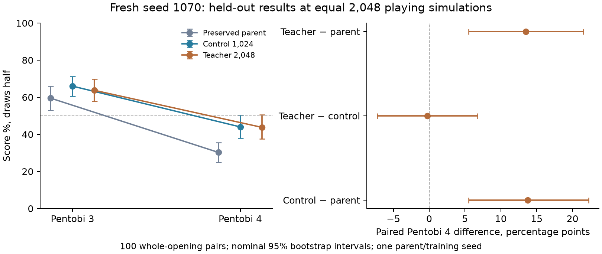

# Integrated speedups and fresh controlled run — 28 October 2026

**Completed at 11:18 EDT on 28 October 2026 and independently verified locally.**
Both branches finished all 64 rounds (16,384 new games each), followed by all
1,200 external and 800 head-to-head games. All compute is stopped. The requested
overnight run actually started at 08:47 EDT that morning; it did not run overnight.

The teacher improved its draw-half score against Pentobi 4 from the parent’s
**30.25% to 43.75%**: **+13.5 percentage points**, nominal paired 95% interval
**+5.5 to +21.5**. This meets the prespecified primary improvement criterion on
this book. The control scored **44.0%**, with no demonstrated teacher advantage:
teacher-minus-control **−0.25 points**, interval **−7.25 to +6.75**. Neither
selected branch establishes a majority score against level 4; both absolute
intervals cross 50%. The stretch goal was not met.

The speedups are implemented and verified. Bulk staging adds **18.7% / 27.1%**
throughput at full-search 1,024 / 2,048 over the already optimized Rust/CUDA Graph
path. This performance result is separate from the learning comparison.

**Recommendation:** replicate with an independent training seed and fresh test
book before scaling. The cheaper 1,024-search training branch is the economical
baseline: it matched level-4 strength here while using less search compute. Keep
both models; this run does not establish equivalence or rule out a teacher benefit.
No further paid run or level advancement was launched.

All six app attempts together metered **$6.83204552**, versus **$22.27935333**
reserved under the **$23 cap**. Shared storage/egress are not allocated per app in
that sum; the final account snapshot is reported below. The $50 reserve is retained.

## What changed

The production Rust engine now generates moves from indexed playable corners and
caches the best PUCT priority during selection. It retains the original placement
scan as a correctness oracle. Native search can emit policy indices directly,
removing repeated Python geometry conversion for search leaves.

Shared inference now supports whole-block staging, direct shared-memory replies,
and immediate batching of ready requests. CUDA Graph inference uses persistent
buffers and caller-owned outputs. Training rebuilds captures after optimizer
updates; frozen validation and playing search can also use graphs.

The neural cache remains disabled because the earlier real-workload test slowed
collection. Channels-last remains unselected because its collection improvement
was small and variable. The [earlier GPU study](cuda-graphs.md) favored L40S over
H100 for this small network and host-driven search. Saturating the H100 in a
GPU-resident microbenchmark did not saturate the complete game/search pipeline.

## Verification and runtime selection

- Rust tests passed, including exact indexed/scan move ordering through complete
  random games and forced passes.
- Original and integrated native extensions matched on 32 complete random games,
  964 positions, and 12 arbitrary-prior roots with 3,072 simulations per engine.
- All 96 Python tests passed, with seven existing warnings. The first sandboxed
  test lacked POSIX shared-memory permission; the full suite passed with access.
- GPU eager/captured outputs passed numerical checks on seven batch sizes before
  and after two discarded optimizer steps. Bulk and row graph outputs matched
  exactly, and output lifetime checks passed.
- Two unpromoted eight-game smoke branches matched model, AdamW, replay and
  CPU/CUDA/NumPy RNG state after interruption/recovery. This narrow single-worker
  result does not establish bitwise replay across asynchronous scheduling.
- The final training auditor also passed the preserved older control: 64 rounds,
  16,384 games, 1,364 gradients and 131,407,680 actual simulations.

Local evidence is under `runs/integrated-speedups-baseline-20261028/` and
`runs/integrated-auditor-historical-smoke.json`. The source-only GPU payload has
19 allowlisted files under `runs/integrated-payload-1070/`; its adjacent SHA256
manifest pins every file. No model, replay or unrelated file was uploaded.
Linux builds use the immutable base image's locked Rust manifests. The final
training audit requires the same native binary/build record as validation.

Frozen-model performance selection uses this prespecified comparison:

| Setting | Values |
|---|---|
| Transport modes | Legacy rows; compact rows + ready batching; compact bulk + ready batching |
| Full search | 1,024 and 2,048; fast 32 on the other 80% of roots |
| Repeats | Two, in reversed order |
| Work per case | 12 warm-up + 256 measured games |
| Parallelism | Six workers, 64 live games each, inference batch 256, leaf batch 8 |
| Inference | Integrated Rust, CUDA Graphs, bfloat16, TF32 allowed, zero wait |

Choose the lowest combined mean collection-plus-capture time among modes no
slower than legacy at either search budget; otherwise keep legacy transport.
The choice uses no learned checkpoint or game-strength test outcome. The twelve
cases contain 3,072 measured and 144 warm-up games, all with frozen weights.
The smoke branches add 16 discarded games and four discarded gradient steps,
separate from the two numerical optimizer probes. None count as study training.

Auditor: `cloud/report_integrated_validation.py`. Plot:
`cloud/plot_integrated_validation.py`. Passing writes
`runs/integrated-validation-verified.json`, which the training launcher requires.

## Fresh matched training study

Run: `duo-integrated-teacher-1070`. Both branches start from the preserved selected
round 112 parent CNN, with 52,978 parameters:

- Parent SHA256: `95569be7c179180c12681255dbcee9884f465e713f418e958a508907beb4d512`.
- Inherited round 128 state SHA256: `df74afa8bf699eb63f9dcf4d32cd13530e7b276f66c63ddd28368049edf75911`.

Both use the identical full 100,000-position replay from that later state and
fresh AdamW, because the later optimizer moments do not match selected weights.
The intentionally stopped earlier study and all its checkpoints stay preserved.

| Setting | Control | Teacher |
|---|---:|---:|
| Full search on recorded 20% of roots | 1,024 | 2,048 |
| Fast search on unrecorded 80% | 32 | 32 |
| Planned additional games | 64 rounds × 256 = 16,384 | 64 rounds × 256 = 16,384 |
| Soft training cap | 6,000 seconds | 10,000 seconds |

Fresh training seed is 1070. Both branches use the same selected runtime, six
workers × 64 live games, inference 256, leaf 8, zero wait, replay 100,000,
AdamW 0.001 / weight decay 0.0001, minibatch 256, training ratio 3, policy CE
weight 0.5 plus terminal WDL MSE, gradient clip 1, CUDA bfloat16 and TF32.
If caps bind, report actual unequal games, experience and compute.

Validation every 16 rounds uses 32 paired openings, seed 2607300, versus the
frozen parent at 512 simulations each. The unchanged parent is selectable at
50%: additional round 0, despite embedded update 112. Freeze selected files
before generating any held-out opening. Tests use 100 fresh four-ply opening
pairs, seed 2607900, both seats:

- Parent/control/teacher each against pinned Pentobi 31.0 Duo levels 3 and 4 at
  2,048 playing simulations: six cases, 1,200 games with full action traces.
- Teacher–control with search 2,048 and raw; teacher–parent raw; control–parent
  raw: 800 games with paired outcomes/counters, without action traces.

Finish all cases regardless of intermediate scores. No next level, extra search,
architecture change or further training is automatic.

Primary success is teacher-minus-parent paired Pentobi 4 score difference with a
nominal whole-opening 95% interval entirely above zero. The parent is retested on
the same book. Teacher-minus-control and head-to-head address benefit from extra
training search beyond more training. Absolute teacher Pentobi 4 score interval
entirely above 50% is a stretch goal. Crossing zero is inconclusive; below zero is
negative evidence. Report raw/search and validation/test separately.

One parent/training seed, inherited later replay, checkpoint selection, unequal
compute and multiple nominal intervals limit generalization. These results do
not establish human Elo, Classic/frontier strength or AlphaBlokus performance.

## Costs, failures and safeguards

Profile `linuxfan2718`; private Volume `blokus-deep-selfplay-20261026`.
Base image `im-g024WcGyhkVNjjImEuEZ1k`. Each function uses L40S, eight capped CPU
cores, 24 GiB RAM, retries 0 and at most one container. Validation hard limit is
1,200 seconds; study hard limit is 28,800 seconds (8 hours). Rate is $2.5204/hour.
Each reservation includes 90 seconds startup; validation also includes $0.15 build
allowance. The combined phase ceiling remains $23, preserving $50 of the original
$130 existing credits. Initial CLI metering was $46.03137374; the launcher floors
prior commitment conservatively at $46.25. No top-up or plan change.

| Attempt | Outcome |
|---|---|
| `ap-KwsyrmMhvZpLz8Xy9P9LSy` | Guard counted its own app; no GPU function submitted. Fixed by excluding the submitting app. |
| `ap-tUfMbBe5gfBIYvlmZ3wD25` | Runner import failed before study code. Explicitly stopped; runner moved to established cloud-module path. |
| `ap-TSgLReotCBET6Pvijbc13n` | Image import test depended on runtime-injected SDK; caught before GPU submission. Build test now checks discovery/compilation. |
| `ap-CioAB9zwQl4m3qfaDzvsrf` | Native comparison passed, then child PYTHONPATH omitted injected SDK. Failed before numerical checks or training. |
| `ap-oOQqAsXkZ1Zg1czJgwIxza` | Corrected validation: child SDK import and mounted Volume commit verified before scientific work. Finished run `duo-integrated-validation-1070-sdk`; locally verified and stopped with zero tasks. |

All earlier attempts are stopped with zero tasks. Their logs, source receipts,
costs and failed run artifacts are preserved. The payload/scientific settings did
not change during wrapper repairs. The ledger retains all original reservations
plus a negative settlement releasing only unused startup reservation and keeping
$1 for **all** failed attempts. Startup metering snapshot was $0.01691356.
Corrected validation reserves $1.05314333; study reserves $20.22621. Net combined
reservation was $22.27935333, under $23. **Reservation is not actual spend.**
All actual failed and successful app costs remain in the final cost report.

Ledger: `runs/modal-integrated-cost-ledger.jsonl`. Exclusive remote directories
refuse duplicate or infrastructure replay. Atomic checkpoints and pairs commit
incrementally. Failure preserves state; no automatic repeated study launch.

After finished markers and stopped app/zero tasks, download to an unused,
pre-created local parent. Run `python -m blokus_rl.duo_integrated_report` with the
run, stopped-app snapshot, app ID and CLI billing report. It audits source,
runtime, optimizer/replay lineage, selection and counters, replays all 1,200
external traces, and recomputes summaries and paired differences. It validates
head-to-head outcomes/counters without claiming action replay for those games.
`cloud/write_integrated_results.py` writes the compact results/plot.

`cloud/backup_integrated.py` verifies every archive member by SHA256 readback.
The initial backup `.backups/integrated-startup-20261028.tar.gz` has 80 verified
members, SHA256 `590631caf8e1ad393d760661128d6bbcc8d2d9dd57e67529fcdb0443b27d8e81`.
At completion: inspect the plot, billing and stopped apps, verify all preserved
models, back up final artifacts, commit validated local code/docs without pushing,
report results and delete the shared follow-up. No next experiment automatically.

## Verified GPU throughput results

All local checks passed after the stopped run was downloaded. The local auditor also compared the saved uninterrupted/recovered smoke states directly. **Bulk staging with compact native indices, ready batching and CUDA Graphs is selected for both training branches.**


| Runtime | Full 1,024: seconds / 256 games | Games/s | Full 2,048: seconds / 256 games | Games/s |
|---|---:|---:|---:|---:|
| legacy | 27.510 | 9.31 | 54.890 | 4.66 |
| compact | 25.177 | 10.17 | 49.340 | 5.19 |
| bulk | 23.185 | 11.04 | 43.173 | 5.93 |

Bulk improves throughput by **18.7%** at full 1,024 and **27.1%** at full 2,048 over the already Rust-optimized, graphed legacy-row path. These gains are not multiplied by earlier unmatched-study ratios. Each mean includes capture time and excludes process startup/warm-up. Repeats use two predetermined round seeds, matched across modes within a repeat; whiskers show their range, not a confidence interval. Scheduling and padded bfloat16 batches can affect trajectories within validated numerical tolerance. This is performance evidence, not learning evidence.

Whole-validation telemetry (126 samples, including startup, numerical checks and smokes): average GPU busy 16.0%, p95 28.8%; mean CPU 4.30/8 cores; peak RAM 13.32/24 GiB; peak VRAM 2704/46068 MiB. This broad sample does not isolate an individual transport's steady-state bottleneck, and does not measure peak FLOPs.

| Provider app | Metered USD at validation completion |
|---|---:|
| ap-CioAB9zwQl4m3qfaDzvsrf | $0.01470139 |
| ap-KwsyrmMhvZpLz8Xy9P9LSy | $0.00088552 |
| ap-TSgLReotCBET6Pvijbc13n | $0.00040576 |
| ap-oOQqAsXkZ1Zg1czJgwIxza | $0.45812312 |
| ap-tUfMbBe5gfBIYvlmZ3wD25 | $0.00092089 |

All these validation/build/startup apps were stopped with zero tasks before the main study launch. Actual costs can settle later; the final billing report must refresh them.


## Full study launch and follow-up

- App: `ap-6udDwXXAr6DC6c49IVqVv7`.
- Function call: `fc-01M618TANN52C02880107VA7TE`.
- Source commit: `382251d8f2389342ccbd4bee1faff79848db27f9`.
- Submitted 08:47 EDT. Provider logs confirmed child SDK/Volume access, branch
  initialization and three saved control rounds: 256, 512 and 768 games. Round
  times were 31.26, 25.67 and 25.42 seconds, including training/checkpoint work.
- One active study; all validation/startup apps stopped. Net reservations are
  $22.27935333 under the unchanged $23 ceiling. This is separate from actual spend.
- The shared follow-up checks completion and runs the prepared independent audit,
  report and backup. It stays quiet for ordinary progress and validation scores,
  reports completion/failure/action, and deletes itself when work is finished.

The complete study may take several hours; its function has an eight-hour hard
limit. The three early training rounds are progress evidence, not a new strength
result. The earlier intentionally stopped study was not resumed or overwritten.

The throughput comparison also helps locate the remaining bottleneck: all three
modes use the same captured neural kernels, yet changing host-side staging and
request/reply handling improves game throughput. Together with the earlier
profile and low broad-sample GPU activity, this points to feeding and coordinating
search work as the remaining constraint. It does not prove that a particular CPU
function dominates, and an idle GPU does not require every CPU core to be busy.
Larger GPU capacity alone has not improved this workload economically.

## Verified full-study results

Primary verdict: **improvement**. All 1,200 external action traces were independently replayed. All 800 head-to-head outcomes and counters were audited; those games have no saved action traces.



| Case | W–D–L | Win rate | Score (draw half) | Nominal 95% score interval | Mean margin | Game seconds | Actual actor simulations | Neural positions |
|---|---:|---:|---:|---:|---:|---:|---:|---:|
| Preserved parent vs level 3 | 114–10–76 | 57.00% | 59.50% | 53.00%–66.00% | 1.05 | 337.9 | 6,432,768 | 4,526,561 |
| Preserved parent vs level 4 | 55–11–134 | 27.50% | 30.25% | 25.00%–35.50% | -4.24 | 366.8 | 6,373,376 | 4,505,413 |
| Control 1,024 vs level 3 | 126–12–62 | 63.00% | 66.00% | 60.50%–71.25% | 2.35 | 359.2 | 6,379,520 | 4,485,304 |
| Control 1,024 vs level 4 | 84–8–108 | 42.00% | 44.00% | 38.00%–50.25% | -2.22 | 364.8 | 6,369,280 | 4,469,137 |
| Teacher 2,048 vs level 3 | 125–5–70 | 62.50% | 63.75% | 57.74%–69.75% | 2.22 | 356.5 | 6,365,184 | 4,504,253 |
| Teacher 2,048 vs level 4 | 81–13–106 | 40.50% | 43.75% | 37.50%–50.50% | -0.98 | 345.5 | 6,397,952 | 4,552,796 |

All cases use 2,048 simulations per searched actor decision. Game seconds include both agents and game work, not pure neural or GPU latency.

| Paired comparison | Score difference | Nominal 95% whole-opening interval |
|---|---:|---:|
| teacher2048-minus-parent-pentobi3 | +4.25pp | -4.25 to +12.50pp |
| teacher2048-minus-control1024-pentobi3 | -2.25pp | -10.75 to +6.25pp |
| control1024-minus-parent-pentobi3 | +6.50pp | -1.75 to +14.75pp |
| teacher2048-minus-parent-pentobi4 | +13.50pp | +5.50 to +21.50pp |
| teacher2048-minus-control1024-pentobi4 | -0.25pp | -7.25 to +6.75pp |
| control1024-minus-parent-pentobi4 | +13.75pp | +5.50 to +22.25pp |

| Branch | Completed rounds / new games | Recorded roots | Gradients | Actual simulations | Collection seconds | Training seconds | Total branch seconds / soft cap | Selected additional round / games |
|---|---:|---:|---:|---:|---:|---:|---:|---:|
| Control 1,024 | 64 / 16,384 | 114,275 | 1,371 | 131,617,952 | 1405.4 | 11.4 | 2411.0 / 6000 | 48 / 12,288 |
| Teacher 2,048 | 64 / 16,384 | 113,482 | 1,364 | 246,995,680 | 2571.1 | 10.9 | 3550.3 / 10000 | 64 / 16,384 |

| Head-to-head | W–D–L | Score | Nominal 95% whole-opening interval | Mean margin | Seconds |
|---|---:|---:|---:|---:|---:|
| teacher-vs-control-search2048 | 99–16–85 | 53.50% | 47.50%–59.50% | 1.19 | 433.8 |
| teacher-vs-control-raw | 94–17–89 | 51.25% | 45.50%–57.00% | -0.33 | 1.3 |
| teacher-vs-parent-raw | 124–10–66 | 64.50% | 58.25%–70.50% | 3.49 | 1.2 |
| control-vs-parent-raw | 97–8–95 | 50.50% | 44.25%–57.00% | 1.48 | 1.1 |

Raw and searched results above remain separate. Validation chose checkpoints; the held-out results did not. The full verification JSON retains validation rows, runtime/source hashes, optimizer/replay checks, exact actor decisions and all paired scores.

| Provider app | Actual metering USD |
|---|---:|
| ap-6udDwXXAr6DC6c49IVqVv7 | $6.35700884 |
| ap-CioAB9zwQl4m3qfaDzvsrf | $0.01470139 |
| ap-KwsyrmMhvZpLz8Xy9P9LSy | $0.00088552 |
| ap-TSgLReotCBET6Pvijbc13n | $0.00040576 |
| ap-oOQqAsXkZ1Zg1czJgwIxza | $0.45812312 |
| ap-tUfMbBe5gfBIYvlmZ3wD25 | $0.00092089 |

Combined net reservation: $22.27935333 under $23; reservation is not actual spend. Whole study helper runtime: 9041.2s. Billing and app lifetime are separate.

A promising primary outcome warrants an independently seeded replication with a prespecified budget; an inconclusive or negative result warrants diagnosis before further training. No next paid run was launched automatically.


## Interpretation, experience and resource limits

Both searched policies improved against the retested parent on the same level-4
book: control **+13.75 points [5.5, 22.25]**, teacher **+13.5 [5.5, 21.5]**. Extra
training helped under this protocol; the additional teacher search has not shown
a further gain. Teacher–control head-to-head scores were **53.5% with search**
[47.5%, 59.5%] and **51.25% raw** [45.5%, 57.0%], both inconclusive. The teacher’s
raw policy beat the parent with **64.5% score** [58.25%, 70.5%]; the control–parent
raw score was **50.5%** [44.25%, 57.0%]. These opponent-specific comparisons do
not establish a transitive ranking or a causal advantage from extra search.

Validation selected control additional round **48 / 12,288 games** and teacher
round **64 / 16,384 games**, before the held-out book. Their weight-lineage
count plus new selected games was **73,728 / 77,824**, respectively; this excludes
separate exposure to the later inherited replay and is not a count of independent
or unique data. Both complete
training branches nevertheless ran the planned **16,384 new games**; neither soft
cap bound and neither overshot it. Selected experience differs, and the teacher
used **87.7% more actual training simulations** and **47.3% more branch wall time**.
The nominal intervals describe opening-book uncertainty, not training-seed
replication. The inherited replay came from later parent round 128 even though
initial selected weights came from round 112. Keep these limits when interpreting
one parent lineage and one training seed.

The raw results and searched results remain separate; validation scores selected
checkpoints and are not held-out success measures. No human Elo, four-player
Classic/frontier or AlphaBlokus performance is inferred. The test book is fresh
relative to previous reports, so old scores are not matched-book baselines.

Whole-main-function telemetry contains **1,798 samples**: GPU busy mean **15.3%**,
median **18%**, p95 **31%**, sampled maximum **53%**; mean CPU **2.46 of 8 cores**;
peak host memory **15.10 of 24 GiB**; peak VRAM **2,704 of 46,068 MiB**. Hardware
was NVIDIA L40S, driver 610.57.04, PyTorch 2.14.1+cu130 / CUDA 13.0. This mixed
sample includes serial external opponents, validation, fitting, checkpointing and
raw games; it is not a phase-isolated profile or a FLOP-utilization measurement.
Neither GPU capacity nor memory capacity was saturated across that mixed workload.
Host coordination, available search work and persistence remain useful targets
before spending on a larger GPU.

Across both branches, fitting took only **22.25 seconds**, collection **3,976.47
seconds**, and branch wall time **5,961.25 seconds**. The remaining time includes
validation, capture preparation, checkpoint serialization, Volume commits and other
overhead. Instrument these separately before attributing all remaining time to a
specific CPU function or changing checkpoint durability. The recorded round timers
exclude the following Volume commit, while full branch wall time includes it.

The helper finished at **11:18:35 EDT**, after **9,041.16 seconds**; the wrapper
finished at **11:18:40 EDT**, after **9,061.39 seconds**, below its eight-hour hard
limit. Total actor decisions in the 1,200 external games were **18,710**, each with
exactly **2,048 simulations**, totaling **38,318,080 simulations**. Training used
**570,536** searched decisions for control (114,275 full / 456,261 fast) and
**569,249** for teacher (113,482 full / 455,767 fast). Mean actual inference batches
were **84.67 / 82.80**. The full verification JSON retains per-case actor decisions,
all neural-position counts and all training/validation counters.

Final auditor command (launches no games):

```sh
MPLCONFIGDIR=.cache/matplotlib .venv/bin/python -m blokus_rl.duo_integrated_report \
  --run runs/integrated-study-final-20261028T152508Z/duo-integrated-teacher-1070 \
  --apps runs/integrated-study-final-20261028T152508Z/stopped-apps.json \
  --app-id ap-6udDwXXAr6DC6c49IVqVv7 \
  --billing runs/integrated-study-final-20261028T152508Z/billing-report.json
```

The completed download and verification are under
`runs/integrated-study-final-20261028T152508Z/`. Frozen control SHA256:
`35b9dd6a49b65f5d3d43f9c8500702385c5131e6f3023892a441fe3a1405c3a4`;
frozen teacher SHA256:
`51f9acc7b52402b1f39610e3db7f17e19ed0e1887c8a906812c8d6de3d78f1e8`.
The parent, original round-128 state, certified models and both intentionally
stopped earlier resume states were verified unchanged. All main, validation and
failed startup costs remain recorded. The main study had no interruption or retry.

## Closeout and reproducible artifacts

The final provider account snapshot metered **$53.03137374 across all account
work**, below the $80 spending allowance that preserves $50 of the original $130.
The study-specific sum is **$6.83204552 across all six app attempts**, including
failed startups and the validation. It is not calculated by subtracting two
possibly unsettled account snapshots. Shared Volume/egress metering is not
assigned to individual app rows. Final billing snapshots and stopped-app evidence
are saved alongside the audited download; all returned apps were stopped with
zero tasks. Prior startup/validation stopped states remain in their saved audits.
No funds were added, no plan changed and no protected reserve released.

Results generation:

```sh
MPLCONFIGDIR=.cache/matplotlib .venv/bin/python cloud/write_integrated_results.py \
  --verification runs/integrated-study-final-20261028T152508Z/verification.json
```

Both figures were visually inspected. The final backup is
`.backups/integrated-study-complete-20261028.tar.gz`, with a SHA256 sidecar and a
full archive-member SHA256 manifest. Every member is read back and compared to
its original hash by the backup script. Local code and documentation are
committed without pushing. The shared completion follow-up is removed after
closeout; there is no automatic next experiment.
