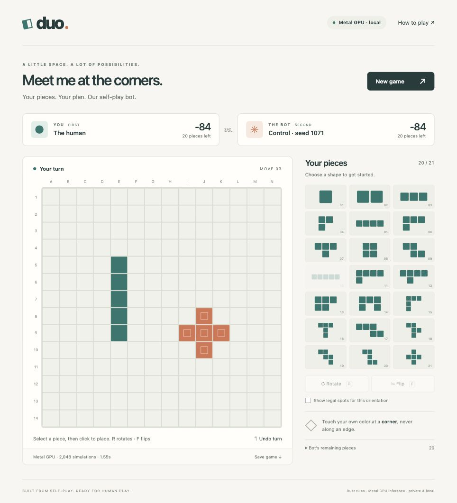

# Play Duo on this Mac

Double-click **Play Blokus.command** in the project folder. It starts a local
Python server and opens your default browser at `http://127.0.0.1:8765`.
Keep its Terminal window running; Control-C stops it. The existing project
`.venv` and downloaded checkpoint files are required. No new packages or cloud
service are needed in this checkout.
Launching again on the same port opens the existing app and retains its game.

The web app selects **Metal/MPS** automatically when accessible, or CUDA on a
CUDA host, otherwise CPU. Its top-right badge shows the actual device. All neural
inference is float32. Rust performs rules and tree search on the CPU. The app
does not train or modify checkpoints.

```sh
# From the project directory:
.venv/bin/blokus-rl duo-web

# Explicit backend, or a different checkpoint/port:
.venv/bin/blokus-rl duo-web --device mps
.venv/bin/blokus-rl duo-web --device cpu --port 8766
.venv/bin/blokus-rl duo-web /absolute/path/to/checkpoint.pt --device auto

# Terminal play also supports Metal, including raw policy inference:
.venv/bin/blokus-rl duo-play /absolute/path/to/checkpoint.pt --device mps --simulations 2048
.venv/bin/blokus-rl duo-play /absolute/path/to/checkpoint.pt --device mps --simulations 0
```

`duo-evaluate` also accepts `--device cpu|mps|cuda|auto`, retaining CPU as its
default. Terminal play and the web app default to auto. Explicit `mps` fails
clearly when unavailable; it does not silently use CPU. Some sandboxed processes
cannot access Metal even though ordinary Terminal can. The web app can be started
with `--no-browser` when a browser should not be opened automatically.

## Mouse and keyboard controls

Click a piece in your tray, point at the board to see a preview, and click to
place it. The pointed square anchors the **top-left of the shape's bounding box**;
it need not be a filled square of the piece. Rotate with **R** or the Rotate
button; flip with **F** or Flip. Escape clears the selection. The selected tray
shape reflects its current orientation. Optional legal-spot dots show valid
anchor squares for exactly that orientation.

Your first piece covers a marked starting square. Later pieces touch your own
color at corners, never at edges. Rust generates all accepted placements; the
browser's preview cannot override it. Passes happen automatically. The game ends
after both players run out of legal placements. Scores include the completion
and final-monomino bonuses.

**Undo turn** removes your latest move and the bot's following moves/passes. It
also works while the bot is thinking: a cancelled/stale search cannot change the
restored board. Starting a new game likewise invalidates the prior search. New
game settings offer either seat, network-only/128/512/2,048 simulations, backend,
and available frozen checkpoints. The default is the seed-1071 replication,
without a claim that it is strongest against every opponent.

Keyboard users can choose pieces with Tab/Enter, navigate board cells with arrow
keys, and place with Enter or Space. Color and text labels identify turns and
occupied cells. Motion respects the operating-system reduced-motion setting.

This server hosts **one game**, shared by tabs pointing at it. Refreshing keeps
the game; restarting the server resets it. Save game downloads a JSON action
record with checkpoint hash, device and search budget. This is a record, not an
import/resume feature. No moves, model files or telemetry are uploaded. The
server binds only to loopback, serves a fixed asset list, and rejects foreign
origins, missing request tokens and stale board versions.

## Metal inference and training are different tasks

The saved 52,978-parameter CNN is approximately 222 KB as a checkpoint, so local
inference is straightforward. Apple silicon runs PyTorch operations through the
**Metal Performance Shaders (`mps`) backend**, not CUDA. The same trained weights
work; they do not need retraining or Core ML conversion. Network and feature
tensors are placed on the selected device for both raw policy and searched
inference. MPS uses the Mac's GPU; this port does not use the Apple Neural Engine.
[PyTorch MPS](https://docs.pytorch.org/docs/2.14/notes/mps.html),
[Apple's PyTorch guidance](https://developer.apple.com/metal/pytorch/).

The self-play trainer has since been **ported to MPS float32**, with optimizer,
RNG and interrupted-run recovery tests. See [Metal training and the measured
L40S comparison](metal-training.md) for commands, results and the explicit
nondeterministic-kernel limitation. The inference app itself never trains.

| Practical issue | Laptop implication |
|---|---|
| Most work is self-play, not gradient updates | The latest Modal control used 131.4 million search simulations and 102.8 million neural evaluations. Optimizer fitting took only 10.2 seconds, versus 1,301.8 seconds collecting games. A fast backward pass alone would not make the study fast. |
| CUDA-specific runtime | Our CUDA Graphs, CUDA staging and bf16/TF32 production paths do not transfer directly to Metal. The measured eager-float32 M2 collection path was about 6× slower than production L40S; see the matched and production comparisons in the Metal training report. |
| Small inference batches | Single-game search makes repeated small CPU↔GPU handoffs. Metal is not guaranteed to beat CPU for this small CNN. Use the actual turn-time display; the first GPU turn includes initialization. |
| Unified memory | The Modal training window peaked at 12.29 GiB host RAM plus about 2.6 GiB GPU memory. Those measurements cannot simply be added to predict M2 use, but on a 16 GB Mac the OS, browser, replay and GPU share a tight budget. Worker count/replay/batches may need reducing, which changes throughput or the protocol. |
| Sustained work | Long self-play runs compete with normal use and may slow under heat or power limits, especially on fanless machines. Sleep/closing the lid can interrupt a job. Recovery is tested at saved round boundaries; in-flight work can be lost. |
| Numerical differences | CPU, Metal float32 and Modal CUDA bf16/TF32 can choose different search moves. Reusing weights does not reproduce GPU bitwise trajectories or the published benchmark result. |
| Cost and iteration | The completed Modal replication cost $2.63 for the full app, including evaluation/profiling, and training reached 16,384 games in about 29.6 minutes. That is an observed cloud run, **not** a measured laptop estimate. No complete M2 training study was run for this port. |

The laptop is a good place for playing, debugging rules/UI, inference profiling,
and local Metal training. Compare the measured throughput before choosing a host
for controlled self-play studies at the existing budgets.
Keep the same audit/recovery standards on either machine. See the
[completed workload profile](control-replication-performance.md) and
[architecture/data diagnosis](architecture-comparison.md).

## Implementation

The UI is original buildless HTML/CSS/JavaScript, with no third-party UI assets
or AlphaBlokus source copied. The backend uses the standard-library HTTP server,
the existing Rust engine and saved model loaders. One background worker owns
inference; HTTP requests remain responsive while it thinks. This is a local play
app, not a public hosting service.

Sources: [backend](../python/blokus_rl/duo_web.py),
[device selection](../python/blokus_rl/duo_device.py),
[frontend](../python/blokus_rl/web/index.html).

## Validation on this Mac — 28 October 2026

- All **115 Python tests passed**, including real Metal raw/search inference,
  complete legal games from both seats, forced passes/final scores, undo after
  endgame passes, stale-request rejection, and reset/undo during an in-flight bot
  turn. The HTTP tests exercised loopback origin/token restrictions. The seven
  existing PettingZoo/TorchRL advisory warnings did not cause failures.
- Three fixed reachable positions from the saved seed-1071 model agreed between
  CPU and Metal: maximum probability difference **1.79e-7**, maximum value
  difference **1.20e-7**. These finite checks are not a bitwise or exhaustive
  equivalence claim. Receipt: `runs/local-play-metal-validation-20261028.json`.
- All **35 previously protected checkpoint hashes** verified unchanged; the
  current seed-1071 model also retained SHA256
  `ba48980382d382786a031e95ad2b60b12d029be1e29f035fec2e04cbe0b84ac5`.
- Browser checks covered mouse placement of rotated/flipped pieces, legal-spot
  previews, undo during bot search, both seats, raw Metal and searched Metal,
  CPU play and alternate model selection. The saved JSON download independently
  replayed legally in Rust with matching scores and a checkpoint hash.
- An observed first-use Metal 2,048-simulation turn took **1.96 seconds**; a CPU
  128-simulation turn took **0.08 seconds**. These are UI smoke checks with
  different budgets/models and warm-up, **not** a matched backend benchmark.
- No optimizer steps, training, paid compute or model/replay uploads were used
  for the inference/UI port. The later Metal training benchmark is documented
  separately. Checkpoint files remain read-only to the app.


