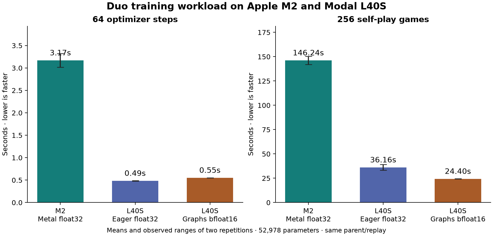

# Metal training and L40S comparison

The Duo self-play trainer now supports **Metal/MPS float32**, including the
existing shared-memory Rust self-play pipeline, policy/value learning, AdamW,
validation, packed replay checkpoints, and interrupted-round recovery. Existing
CPU/CUDA defaults and exact-config recovery remain supported.

## Train locally

From this checkout:

```sh
.venv/bin/python -m blokus_rl.duo_metal_train --out runs/my-metal-training
```

This starts a new continuation from our preserved selected round-112 CNN and
the matching saved state's 100,000-position replay, with fresh AdamW and a
declared new seed. The latest-state optimizer belongs to other weights, so it is
deliberately reset rather than mismatched to the selected model. Inputs are read
only; a pre-existing output directory is rejected. The convenient entry point
uses four workers/32 live games per worker on this 16 GB Mac, float32, eager
inference, full search 1,024 on recorded 20% of decisions and fast 32 on the
remaining 80%. Other learning settings retain the existing recipe.

It defaults to 64×256 games with a 6,000-second soft cap and periodic validation.
Those are limits, not a promise that this workload is appropriate for every Mac.
For a smaller explicitly requested run, override the fixed budgets before
starting, for example `--rounds 2 --games-per-round 16 --workers 2`.

To recover, repeat the same command and all original arguments with `--resume`.
Recovery rejects changed configuration, reference or inference runtime. It
restores model, AdamW moments/counters, packed replay/order, selection, CPU and
NumPy RNG, and now **Metal RNG**. `--parent` and `--source-state` can identify a
different matching selected-checkpoint/state pair; mismatched tensors are
rejected. None of the prior certified models is overwritten.

The generic cold-start trainer also accepts Metal:

```sh
.venv/bin/python -m blokus_rl.duo_deep \
  --device mps --precision float32 --architecture conv \
  --out runs/new-metal-cold-start --reference /absolute/path/to/reference.pt
```

That command creates random initial weights; the reference is for validation.
It is different from continuing an already trained parent.

## Metal-specific limits

MPS currently requires **float32** in this port. CUDA Graphs are rejected before
creating a run; ordinary eager Metal inference is used for collection and
evaluation. CPU/CUDA training retains its previous strict deterministic setting.

PyTorch 2.14.1's MPS indexed-policy backward pass uses scatter-reduce and
accumulating index-put kernels without deterministic implementations. Metal
training explicitly enables deterministic algorithms in **warning-only mode**,
emits PyTorch's warnings, and records that choice in the atomic run's runtime
metadata. Repeated updates can differ slightly even with identical input rows
and RNG states. Recovery tests verify restored state and numerical agreement;
we do **not** claim bitwise replay on Metal or across hardware/scheduling.

Metal RNG state is captured and restored using PyTorch's
[get_rng_state](https://docs.pytorch.org/docs/2.14/generated/torch.mps.get_rng_state.html)
and [set_rng_state](https://docs.pytorch.org/docs/2.14/generated/torch.mps.set_rng_state.html).
The [AdamW implementation](https://docs.pytorch.org/docs/2.14/generated/torch.optim.AdamW.html)
operates on the Metal model's parameters and moment tensors. CPU replay sampling,
packing, game rules and tree traversal remain CPU work.

## Benchmark protocol

We use the **Apple M2, 16 GB unified RAM, eight CPU cores** and an **NVIDIA L40S**
on Modal with eight capped CPU cores and 24 GiB host RAM. L40S is the current
production GPU. The earlier H100 collection study did not establish a cost or
speed advantage for this small, host-driven workload, so this comparison does
not book another H100. [Earlier GPU comparison](cuda-graphs.md).

Three configurations are measured:

1. M2 Metal: float32, eager inference.
2. L40S matched path: float32, eager, TF32 disabled.
3. L40S production path: CUDA Graph collection, bfloat16 autocast, TF32 permitted.

All use the same preserved 52,978-parameter parent, identical 100,000-position
inherited replay, seeded sampling, fresh AdamW and learning hyperparameters.
The parent file SHA256 is
`95569be7c179180c12681255dbcee9884f465e713f418e958a508907beb4d512`, and the replay
source-state SHA256 is
`df74afa8bf699eb63f9dcf4d32cd13530e7b276f66c63ddd28368049edf75911`.

Each configuration runs two repetitions of:

- **Replay fitting:** 64 optimizer steps, minibatch 256, identical sampled-row
  schedule. This includes real CPU sampling/packing, transfers, both losses,
  backward, clipping and AdamW; it is not a GPU-resident synthetic kernel test.
- **One self-play round:** 256 complete games, six workers/64 live games, inference
  limit 256, leaf batch 8, shared-memory/bulk/compact/ready batching, zero wait,
  no cache, 20% full 1,024 / 80% fast 32. New records enter the fixed replay
  window, then fitting uses the normal ratio of three examples per new root.
- **Checkpoint:** packed replay, model, optimizer and RNG are written to a
  temporary checkpoint, reloaded and verified. Readback verification is outside
  timed round latency. This is local filesystem I/O, not a Modal Volume commit.

Two optimizer warm-up steps and 12 warm-up collection games per configuration
are discarded. Each repetition resets weights and optimizer to the same parent;
the second repetition is not a continuation of the first. Round-cycle timing
includes collection, fitting and checkpoint writing, but excludes initial data
load, worker startup, validation and Volume commits. Complete-function/provider
cost includes paid setup/builds/warm-ups and surrounding work.

Different floating-point backends and asynchronous batches may produce different
game trajectories. We report actual simulations, neural positions, roots and
gradients alongside games/second. Two repetitions provide descriptive ranges,
not confidence intervals or evidence of playing-strength improvement. All
optimizer outputs are benchmark copies and are discarded; no selected/deployed
model is replaced. The benchmark uses six workers on both hosts, which differs
from the convenient Metal training entry point's four-worker default.

The single L40S function has a 900-second hard limit, no retries, one maximum
container, and a **$1.50 phase ceiling**. Reservation is **$0.84311**, including
startup/build allowance at $2.5204/hour. It retains $50 of the original $130
credits. Only eight allowlisted source files are uploaded; parent/replay already
exist in the private Volume. Ledger:
`runs/modal-metal-training-cost-ledger.jsonl`. Reservations are not actual spend.

The code passed all **118 local Python tests**, including actual Metal optimizer
updates, RNG restoration, optimizer recovery, full trainer interruption/recovery,
and prior CPU/CUDA/gameplay regression checks. Metal-specific warnings are
expected and documented above. An additional small CPU benchmark smoke verified
collection counters and checkpoint readback before paid launch.

Implementation: [training device](../python/blokus_rl/duo_training_device.py),
[trainer](../python/blokus_rl/duo_deep.py),
[local continuation entry point](../python/blokus_rl/duo_metal_train.py),
[benchmark](../python/blokus_rl/duo_training_benchmark.py),
[bounded Modal launcher](../cloud/modal_metal_training.py).

## Measured results — 28 October 2026

All three cases completed. Values are **mean [observed minimum–maximum]** of two
repetitions; ranges are not confidence intervals.

| Work | M2 Metal float32 | L40S float32 eager | L40S production |
|---|---:|---:|---:|
| 64 optimizer steps, 16,384 examples | 3.170 s [3.016–3.324] | 0.485 s [0.478–0.492] | 0.552 s [0.551–0.554] |
| Collect 256 complete games | 146.24 s [142.10–150.37] | 36.16 s [33.23–39.10] | 24.40 s [24.33–24.46] |
| Complete measured round cycle | 148.23 s [144.08–152.39] | 36.90 s [33.92–39.89] | 25.36 s [25.29–25.43] |
| Collection games/second, pooled work/time | 1.751 | 7.079 | 10.494 |
| Search simulations/second | 14,055 | 56,837 | 84,581 |
| Neural positions/second | 10,990 | 44,444 | 65,996 |



The L40S was **4.04× faster** for collection on the matched float32/eager path,
and **5.99× faster** with the production runtime. Matched optimizer fitting was
6.54× faster. These compare two whole hosts/backends, including different CPUs,
memory and OS; they do not isolate the GPU silicon. Production combines CUDA
Graphs and bfloat16/TF32, so this experiment does not assign separate gains to
each. Its optimizer-only time was slightly worse than CUDA float32 for this
tiny network, while collection was substantially faster.

The M2's two measured rounds used 4,110,720 simulations, 3,214,454 neural
positions, 3,566 recorded roots and 14,348 fast roots. Matched CUDA used the same
root/simulation counts and 3,214,460 neural positions. Production used
4,126,752 simulations, 3,220,003 neural positions, 3,584 recorded roots and
14,273 fast roots. Each case performed 43 round-fitting gradient steps in total,
in addition to the separately timed 128 fitting steps and discarded warm-ups.
Different numerical backends need not generate identical game trajectories.

On the M2, each round's fitting took only 1.22–1.26 seconds. The inference
service accounted for 139.39–147.50 seconds inside the 142.10–150.37-second
collection window (overlapping worker search time must not be added to that).
The practical bottleneck is repeated inference service during self-play,
including dispatch/transfers and feature work. This timing is not a Metal
kernel-level profile and cannot separate those costs. A faster backward pass
would save little of the complete round.

At this six-worker, fixed-parent rate, 64 measured round cycles project to
**about 2 h 38 min on M2 versus 27 min on production L40S**, before validation,
startup and Volume commits. That is a rough projection, not a completed learning
run: changing weights/game lengths, heat, background apps and the convenient
four-worker default can change throughput. The local entry point's 100-minute
soft cap may therefore stop before all 64 rounds. Start with a short run and
choose the work/time budget explicitly for a longer study.

The local benchmark's main-process peak RSS was 1.96 GiB; it excludes workers
and is **not total application memory**. Metal driver allocation at the end was
1.09 GiB, not a peak and not safely additive to RSS on unified memory. The
benchmark successfully used the full 100,000-position replay on this 16 GB Mac;
it does not establish spare memory during a long run with other applications.
Metal CPU-fallback enablement was off. PyTorch versions were 2.14.1 on M2 and
2.14.1+cu130 on L40S, both using NumPy 2.5.4.

**Recommendation:** use Metal for local experiments and debugging; keep the
production L40S path for larger controlled self-play studies when turnaround
matters. This port establishes working learning/recovery and measured speed,
not an improved playing-strength result. No long training study was launched
as part of this timing comparison.

## Verification, time and cost

The GPU app `ap-gL3LWke1O5eLx7eMCNp1yR` was created **28 October at 17:59:37 EDT**,
finished its function at **18:03:30 EDT**, and was stopped with zero tasks by
**18:03:44 EDT**. The wrapper measured 178.74 seconds; the individual eager and
production subprocesses measured 93.32 and 66.67 seconds. The Mac benchmark
measured 328.45 seconds including its setup/warm-ups. These durations cover
different scopes and must not be substituted for provider billing.

Provider metering for this app was **$0.13451787**: L40S $0.10400000,
CPU $0.02026694, memory $0.01025093, versus the $0.84311 reservation and $1.50
ceiling. The reserved maximum was not spent. The final account metering snapshot
was $55.68137374, retaining more than $50 of the original $130. Only this one
comparison app was launched. Source build/setup/warm-up costs are included in
app metering; existing shared storage/account adjustments are recorded in the
separate account summary and are not assigned to this app.

The local auditor [report_metal_training.py](../cloud/report_metal_training.py)
verified original source commit
`3d3a8031ac907b2dabd3b2c8b69c564c0ae105b2`, runner/payload hashes, common parent
tensors/replay inputs, all fixed-work/counter identities, finite optimizer
results, temporary checkpoint readback, stopped compute, provider costs and all
35 protected prior checkpoint hashes. The current seed-1071 selected model was
also rehashed separately. The only benchmark outputs retained are timing and
audit artifacts; learned copies were discarded. All 118 tests passed, including
Metal optimizer/RNG/AdamW and interrupted self-play recovery. MPS scatter/index
backward warnings remain an explicit limitation.

Raw artifacts: `runs/metal-training-mac-1090/`,
`runs/metal-training-modal-final-20261028T2205Z/`,
`runs/metal-training-verified.json`, and the adjacent logs, provider snapshots,
source payload and cost ledger. The independent report writes its verified
record only after its checks and static plot succeed. The first local plot
attempt exited during GUI-backend initialization; the report now explicitly
uses Matplotlib's noninteractive Agg backend. No benchmark was repeated.

Local backup: `.backups/metal-training-complete-20261028.tar.gz`, with SHA256
sidecar and an internal per-member manifest. Every archived member is hashed
again after compression/readback. Source/docs are committed locally; nothing
is pushed or published.
