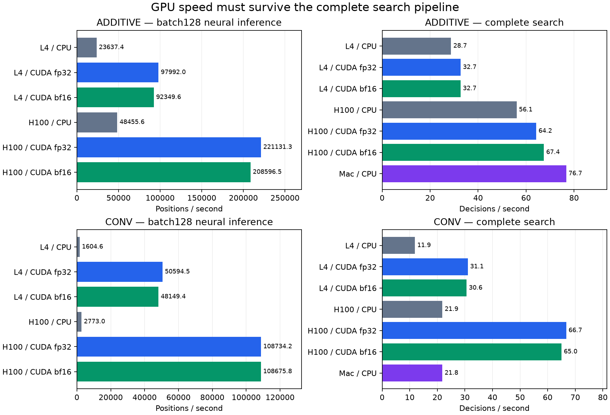

# Modal hardware measurements — 25 October 2026

Timing benchmark only: these measurements do not establish playing strength.
All searches use 128 simulations/move, eight leaves/tree/batch, one Python
coordinator and one PyTorch CPU thread. Every mode starts from the same
weights within its architecture. The additive model is frozen frontier342;
the CNN is seeded, untrained. Synthetic gradient updates are discarded.
CUDA fp32 permits TF32; bf16 uses autocast. Precision can change search
paths. Cloud CPU baselines run on the GPU host; the Mac was timed separately.

## Complete search pipeline

32 concurrent games, four random opening plies, then four searched plies:
128 decisions and 16,384 simulations per row. This includes Rust legality,
tree traversal, observations, ragged candidate packing, transfers and inference.
A timing row is one workload execution, not a confidence interval.

| Host GPU | Model | Execution | Decisions/s | Neural positions | Neural batches |
| --- | --- | --- | ---: | ---: | ---: |
| NVIDIA L4 | additive | CPU | 28.72 | 16512 | 140 |
| NVIDIA L4 | additive | CUDA fp32 | 32.71 | 16512 | 140 |
| NVIDIA L4 | additive | CUDA bf16 | 32.69 | 16512 | 140 |
| NVIDIA L4 | conv | CPU | 11.89 | 16512 | 132 |
| NVIDIA L4 | conv | CUDA fp32 | 31.06 | 16512 | 132 |
| NVIDIA L4 | conv | CUDA bf16 | 30.59 | 16512 | 132 |
| NVIDIA H100 80GB HBM3 | additive | CPU | 56.05 | 16512 | 140 |
| NVIDIA H100 80GB HBM3 | additive | CUDA fp32 | 64.22 | 16512 | 140 |
| NVIDIA H100 80GB HBM3 | additive | CUDA bf16 | 67.42 | 16512 | 140 |
| NVIDIA H100 80GB HBM3 | conv | CPU | 21.85 | 16512 | 132 |
| NVIDIA H100 80GB HBM3 | conv | CUDA fp32 | 66.73 | 16512 | 132 |
| NVIDIA H100 80GB HBM3 | conv | CUDA bf16 | 65.02 | 16512 | 132 |
| Dennis's Mac | additive | CPU, median of 2 | 76.74 | 16512 | 140 |
| Dennis's Mac | conv | CPU, median of 2 | 21.83 | 16512 | 132 |

## Neural inference and synthetic gradient timing

Inference uses the initial board with 828 legal moves, batch128; median of
ten timings after three warmups, including copying outputs back to CPU.
Training includes packing, optimizer setup on first step, and twelve updates
on repeated initial-board records; this is not a representative learning curve.

| Host GPU | Model | Execution | Batch128 inference ms | 12 gradient steps s |
| --- | --- | --- | ---: | ---: |
| NVIDIA L4 | additive | CPU | 5.415 | 0.257 |
| NVIDIA L4 | additive | CUDA fp32 | 1.306 | 0.664 |
| NVIDIA L4 | additive | CUDA bf16 | 1.386 | 0.262 |
| NVIDIA L4 | conv | CPU | 79.768 | 2.245 |
| NVIDIA L4 | conv | CUDA fp32 | 2.530 | 0.338 |
| NVIDIA L4 | conv | CUDA bf16 | 2.658 | 0.368 |
| NVIDIA H100 80GB HBM3 | additive | CPU | 2.642 | 0.119 |
| NVIDIA H100 80GB HBM3 | additive | CUDA fp32 | 0.579 | 0.364 |
| NVIDIA H100 80GB HBM3 | additive | CUDA bf16 | 0.614 | 0.108 |
| NVIDIA H100 80GB HBM3 | conv | CPU | 46.159 | 1.347 |
| NVIDIA H100 80GB HBM3 | conv | CUDA fp32 | 1.177 | 0.185 |
| NVIDIA H100 80GB HBM3 | conv | CUDA bf16 | 1.178 | 0.216 |

## Run records

- `runs/modal-benchmark-l4-260642.json`: NVIDIA L4, PyTorch2.14.1+cu130, CUDA13.0, 47.9s measured workload; $0.0140 estimated execution resources.
- `runs/modal-benchmark-h100-260642.json`: NVIDIA H100 80GB HBM3, PyTorch2.14.1+cu130, CUDA13.0, 24.7s measured workload; $0.0288 estimated execution resources.
- `runs/modal-matched-mac-cpu-260642.json`: local Mac CPU, PyTorch2.14.1; one eight-game warmup plus two 32-game measurements per architecture.

Resource estimates exclude image builds, startup, idle time and metering
differences. Account billing snapshots and the reservation ledger are saved
under runs/. The experiment note records the final budget assessment.
