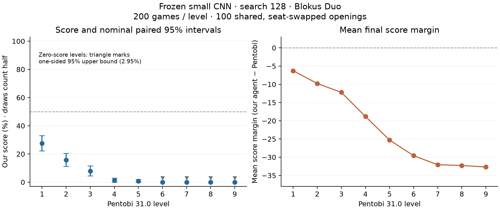

# Pentobi levels 1–9 benchmark — 26 October 2026

**The frozen small CNN with 128 search simulations remains below Pentobi level 1
under this protocol.** Its level 1 score is 27.50% (nominal paired 95% interval
22.25%–33.00%). Scores fall with stronger levels; levels 6–9 each won all 200 games.
This benchmarks the earlier selected model, not the new continuation agents
whose training is still running.



## Complete held-out results

Score is wins plus half draws, divided by games. Each row uses 100 identical
four-ply random opening positions, with both seats played: 200 games/level and
1,800 games overall. Seed 2579000 was fresh and did not select this checkpoint.

| Pentobi level | Our W/D/L | Our score | Nominal 95% uncertainty | Mean margin | Mean game seconds |
| --- | ---: | ---: | --- | ---: | ---: |
| 1 | 52/6/142 | 27.50% | 22.25%–33.00% | -6.27 | 0.92 |
| 2 | 28/7/165 | 15.75% | 11.25%–20.50% | -9.78 | 0.91 |
| 3 | 15/1/184 | 7.75% | 4.50%–11.50% | -12.21 | 0.92 |
| 4 | 2/1/197 | 1.25% | 0.00%–3.00% | -18.83 | 0.95 |
| 5 | 1/1/198 | 0.75% | 0.00%–2.00% | -25.27 | 1.04 |
| 6 | 0/0/200 | 0.00% | ≤2.95% (one-sided) | -29.58 | 1.62 |
| 7 | 0/0/200 | 0.00% | ≤2.95% (one-sided) | -32.06 | 14.49 |
| 8 | 0/0/200 | 0.00% | ≤2.95% (one-sided) | -32.25 | 56.76 |
| 9 | 0/0/200 | 0.00% | ≤2.95% (one-sided) | -32.69 | 232.45 |

The game seconds include both agents' decisions and protocol overhead, under
eight concurrent workers. They are not per-move times or CPU-second totals.
The margin is our final score minus Pentobi's final score.

Intervals resample entire opening pairs 10,000 times, not 200 independent games.
For zero scores, an ordinary bootstrap degenerates to [0,0]; the table instead
shows a conservative one-sided 95% upper bound of 2.95% based on 100 pairs. It does
not establish a true success probability of exactly zero. These are nominal
intervals without adjustment for nine comparisons, and do not include training
seed uncertainty or systematic precision/backend differences.

## What played

- Our agent: frozen 52,978-parameter shallow CNN, selected round 128 after 32,768
  cold-start self-play games; 128 MCTS simulations per decision, CPU float32,
  one PyTorch thread per worker.
- Model SHA256: `0ba92438d27fb72f23364547ba3717729464ace9af23a414cfdff1cbd3298f86`.
- Pentobi 31.0, pinned commit d5374ddc20eced902788e733d67ee16bd1836fd3;
  Duo, native levels 1–9, one thread, no opening book or resignation, default
  symmetric-draw setting. Its strength levels are not human Elo ratings.
- This is fixed-agent strength testing, not equal wall time or equal search
  compute. Pentobi's simulations and our neural-leaf simulations differ.

Actual actor totals: **3,829,248 search simulations** over
**29,916 decisions**, with **2,939,535 neural positions
evaluated**. Every decision's 128-simulation budget was checked from its replayed
turn count. Actual Pentobi node counts were not collected; native level settings
were retained. This is evaluation only, with no new training games or gradients.

## Recovery and verification

Modal preempted the first CPU container. Its infrastructure restart encountered
our existing-directory guard and stopped. Dennis explicitly approved one
recovery. The recovery reused the exact original installed image, binary,
model, code and experimental protocol, computing only 80 missing whole pairs.
All 820 previously saved pair files are byte-for-byte unchanged. All 900 pairs
have the required unique indices, seat/seed assignments and opening prefixes.
All 1,800 games were independently replayed locally: every move was legal and
all terminal scores and margins agreed with the stored Rust/Pentobi results.
Frozen hashes, summaries and simulation accounting were verified independently.

The recovery host emitted unsupported-NNPACK warnings while PyTorch continued
with a fallback. The original protocol already allowed cross-host floating-point
differences: CPU float32 does not promise identical moves across hardware/backends.
The final 160 games (8.9%) ran in recovery. This remains a mixed-host benchmark
of the same frozen policy/search settings; we did not rerun or replace old games
to make the results look uniform. The final log-tail timeout occurred after the
successful return; completed.json, hardware.json and both stopped apps verify
completion. No further games in this level benchmark are scheduled.

## Time and credits

Original app active lifetime: **2.015h**;
recovery app lifetime: **0.406h**;
combined **2.421h**, excluding the approval gap.
App lifetimes include startup/cleanup and are not exact useful compute time.
Recovery function duration alone: **1413.80s**;
it must not be mistaken for the entire benchmark duration.

Provider snapshot: original app **$1.13421**, approved recovery
**$0.69018**, combined **$1.82439 metered**.
Workspace charges were covered by existing credits/allowances in the current
summary. Metering/storage/egress accounting can lag. This is distinct from
**$4.76284** conservative reservations under the original **$5** phase ceiling.
No GPU was used by this benchmark. The separate GPU study continues within its
own budget and is not included in these app costs.

## Interpretation

The current benchmark places this frozen agent below the easiest Pentobi level
on these paired random openings. We cannot assign it an interpolated Pentobi
level or human Elo. It sometimes beats levels 1–3, but its score at every level
is below 50%, with the level 1 interval also below 50%.

The earlier GPU-bfloat16 test reported 31.25% against level 1 on a different book
(seed 2569000). Today's 27.50% uses a fresh book and CPU float32. The difference is
not enough to establish model regression: the weights are unchanged, the intervals overlap,
and openings/precision/grouping differ. This table is the complete consistent
level sweep for the declared mixed-host CPU protocol.

The baseline and stronger-search continuations remain a separate experiment
with new validation/test seeds. Nothing in this benchmark changes their frozen
selection or playing-time search budgets. No AlphaBlokus match was run; these
Duo results do not establish four-player Classic or frontier strength.

## Artifacts and reproduction

Rolling audit: [pentobi-level-status.md](pentobi-level-status.md).
Data: `runs/duo-pentobi-ladder-final-20261026T1550/duo-pentobi-ladder-2579000`. Download manifest/verification files are in its parent directory.
Provider snapshots: `runs/blokus-billing-report-20261026T1550.json` and `runs/blokus-apps-20261026T1550.json`. All earlier certified models
are preserved; no checkpoints were overwritten by this report.

```sh
.venv/bin/python -m blokus_rl.duo_pentobi_report --run runs/duo-pentobi-ladder-final-20261026T1550/duo-pentobi-ladder-2579000 --old-manifest runs/duo-pentobi-ladder-interrupted-20261026T1450/interruption-verified.json --billing runs/blokus-billing-report-20261026T1550.json --apps runs/blokus-apps-20261026T1550.json --out docs/pentobi-level-results.md
```

This command validates existing results and renders the report; it starts no
training, games or paid compute.
