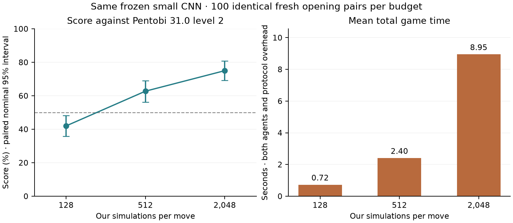

# Frozen-agent playing-search sweep — 26 October 2026

## Completed results

The prespecified 2,048-minus-128 score difference was **+33.00 percentage points**, with a nominal paired 95% interval of **+24.75 to +41.50 points**. The interval is above zero, supporting a benefit from extra playing search for this frozen agent.



| Simulations/move | W/D/L | Win rate | Score | Nominal paired 95% interval | Mean margin | Mean game seconds |
| --- | ---: | ---: | ---: | ---: | ---: | ---: |
| 128 | 77/14/109 | 38.50% | 42.00% | 35.75%–48.25% | -2.165 | 0.721 |
| 512 | 118/15/67 | 59.00% | 62.75% | 56.25%–69.00% | 1.180 | 2.401 |
| 2,048 | 143/14/43 | 71.50% | 75.00% | 69.25%–80.75% | 4.180 | 8.946 |

Score counts draws as half. Each budget completed 200 games on the same 100 fresh openings. Per-game time includes both agents and protocol overhead; it is not GPU-only or our-agent-only latency. The prior 31.5% level 2 score used another book, so the new 128 baseline is not a controlled change in model strength.

The 512- and 2,048-simulation agents both have absolute-score intervals above 50% against Pentobi level 2 here. The network did not learn during this experiment: additional planning alone changed the results. This supports useful planning headroom for the current network, but does not establish that further training will reproduce the same gain at a smaller playing budget.

| Paired score difference | Difference | Nominal 95% interval |
| --- | ---: | ---: |
| 2048-128 simulations | +33.00pp | +24.75 to +41.50pp |
| 512-128 simulations | +20.75pp | +12.75 to +28.50pp |
| 2048-512 simulations | +12.25pp | +5.25 to +19.25pp |

### Actual execution and verification

One NVIDIA L40S, two capped cores, 8 GiB RAM; PyTorch 2.14.1+cu130, CUDA 13.0, bfloat16. Function runtime 2465.46 seconds; app lifetime 2487 seconds. Provider metering at the saved snapshot: **$1.45024814**, versus the $4.269915 conservative reservation and $5 phase cap. Accounting can lag. All compute is stopped and the $50 reserve stays uncommitted.

No preemption, retry, scientific-protocol change or time-limit truncation occurred. All three prespecified budgets finished, regardless of interim scores. Only the prepared runner was uploaded; the model remained in its existing private Volume and its source hash also passed the runner's end-of-job check.

| Budget | Actual searched decisions | Actual simulations | Neural positions | Arm wall seconds |
| --- | ---: | ---: | ---: | ---: |
| 128 | 3,062 | 391,936 | 318,851 | 161.15 |
| 512 | 3,077 | 1,575,424 | 1,179,148 | 497.64 |
| 2048 | 3,090 | 6,328,320 | 4,403,645 | 1804.12 |

All 600 saved games were independently replayed through Rust: legal moves, scores/margins, opening prefixes, seats/seeds and exact actor simulation counts matched. Frozen model, immutable evaluator, Pentobi binary and executed runner hashes passed. Every pair summary and paired interval was recomputed. Certified earlier checkpoints remain unchanged. No new training or model selection occurred. Search can change trajectories and game length; simulation totals therefore need not scale exactly with the nominal budget. Nominal paired intervals exclude training-seed, lineage and hardware uncertainty, and secondary tests are not multiplicity adjusted. This evaluates thinking time for one fixed model against one fixed opponent level, not training improvement or the Blokus frontier.

Complete artifacts: `runs/duo-playing-search-sweep-final-20261026T2207/duo-playing-search-sweep-2601000`. Derived audit and all downloaded hashes: `runs/duo-playing-search-sweep-final-20261026T2207/verification.json` and `download-sha256.json`. Reproduce locally with `python -m blokus_rl.duo_search_sweep_report --run <run> --apps <stopped-apps.json> --billing <provider-report.json> --out docs/playing-search-sweep.md`; no games are launched by the reporter.

## Predeclared design

Dennis approved the proposed search-budget experiment. This changes thinking
time only: the selected strong1024 small CNN is frozen; no training occurs.
The previous level 2 test scored 31.5% at 128 simulations, on a different book.

Complete 100 fresh four-ply opening pairs at each of 128, 512, 2,048 simulations:
200 games/budget, 600 total, seed 2601000, identical book/seats/Pentobi seeds across
budgets. Pentobi 31.0 Duo level 2, one thread, no book/resignation; our inference
is CUDA bfloat16, TF32 permitted. Keep all results and finish all three budgets
regardless of interim scores. Compare runtime as well as strength.

Primary: paired score difference 2048 minus 128; lower nominal 95% paired interval
above zero supports an improvement for this frozen model/book distribution.
Secondary: 512 minus 128, 2048 minus 512, absolute scores/WDL/margins and runtime.
Resample whole opening pairs together across budgets (10,000 draws, seed 17).
Report absolute-score intervals too; winning above 50% against Pentobi is a
separate question. These are nominal intervals for one model, not training-seed
replication, a guarantee of monotonic improvement or a human Elo rating.

Model SHA256:
`95569be7c179180c12681255dbcee9884f465e713f418e958a508907beb4d512`.
It remains in the private Volume blokus-deep-selfplay-20261026, at
duo-continuation-865/frozen-strong1024.pt. Reuse immutable image
im-BnyLYweX6vlwu6iCpDnqrC and its validated evaluator SHA256
`80727fc7fee1fcdab75eebc989f41f617e6721d4f546e266367ca53f294a0493`.
Only cloud/modal_search_sweep.py is uploaded; no model/replay or unrelated files.
Each arm retains atomic whole-pair traces and native/actor budget counters.

One detached L40S, 2 capped cores, 8 GiB RAM, 2-hour hard timeout, retries 0,
max 1 container. Rates verified from provider billing: GPU $1.95/hour,
CPU $0.0473/core-hour, RAM $0.008/GiB-hour. Reserve $4.269915 under a $5 phase ceiling;
keep $50 of the original $130 credits uncommitted. No duplicate, automatic repeated
retry, larger study, top-up, publication, push, messages to people or subagents.
If interrupted, preserve committed pairs and diagnose before any recovery.

Run: duo-playing-search-sweep-2601000. Ledger:
runs/modal-search-sweep-cost-ledger.jsonl. Before launch check apps, processes
and provider billing. Existing playing/training studies are complete and stopped.
The underlying evaluator's targeted tests include a real Pentobi match, exact
missing-pair recovery and configuration rejection. Re-run those tests plus
lint/compile checks before launching the new orchestration wrapper.

Launch once:

```sh
.venv-modal/bin/modal run --detach --profile linuxfan2718 cloud/modal_search_sweep.py > runs/duo-playing-search-sweep-2601000.log 2>&1
```

On finished.json/hardware.json and stopped app, download into an unused existing
parent directory, verify model/evaluator/binary hashes and exact shared book,
replay all 600 games, check every simulation count, recompute paired differences,
produce a compact score/runtime plot and results below, inspect actual costs,
back up all new artifacts and commit validated code/docs locally. Preserve every
earlier model. Remove any follow-up after final reporting; no further automatic
training or benchmark is part of this authorization.

## Launch and completion audit

Launched once at 17:23 EDT: app ap-UrnuIYPY5ezlfrtdOYyGsy, one L40S container.
Source commit c0bb61ad4fb643006be2414ea8c2d9af784a17d3; exact executed runner
SHA256 62c485d843e21038d51834a6a080f5521cc3764e0f4a7e8dd7e1adf96042fe72.
The launcher saved the runner and billing snapshot beside its single ledger
entry. Active apps/processes were checked first; earlier runs are stopped.
Only this new runner was uploaded. The immutable evaluator and private model
hash checks passed. All three budgets completed at 18:04 EDT, and the app
stopped at 18:05:02 with zero tasks. There was no retry or protocol change.

Both targeted evaluator tests passed (1.99 seconds), including a separate real
Pentobi match. New wrapper lint/format/compilation and diff checks passed.
The prepared local audit/report entry point is
python/blokus_rl/duo_search_sweep_report.py. It requires finished artifacts and a
stopped app; it never launches games. Do not interpret an interim arm as the
completed sweep or change the reserved budget/book in response.

The quiet 5-minute follow-up finish-frozen-blokus-search-sweep monitors only this
bounded study; it is removed after the completed report and verified backup. It must
not start new training, duplicate evaluation or notify intermediate scores.

## Final local preservation

The complete download contains 325 files / 1,297,874 bytes. The derived audit
and every downloaded hash are stored beside it. The score/runtime plot was
visually inspected, and Ruff formatting/lint plus diff checks passed. No engine
or training code changed during this experiment.

Verified backup: .backups/playing-search-sweep-final-20261026.tar.gz,
895,191 bytes, SHA256
`a8cee4ce3f4371e8b279c7f51a654cc71d4410eaf341563f2fd7bfe549a1bd00`.
All 346 archived members were read back and matched their source hashes;
the sidecar JSON records the complete manifest. The archive includes every
new game/model artifact, audits, exact executed source, provider snapshots,
report/plot and relevant code/docs. This is a second local copy.

All paid compute is stopped. The completed sweep needs no further evaluation
or training; its follow-up is removed upon final reporting. Subsequent ideas
remain proposals and do not release the reserved credit balance.
