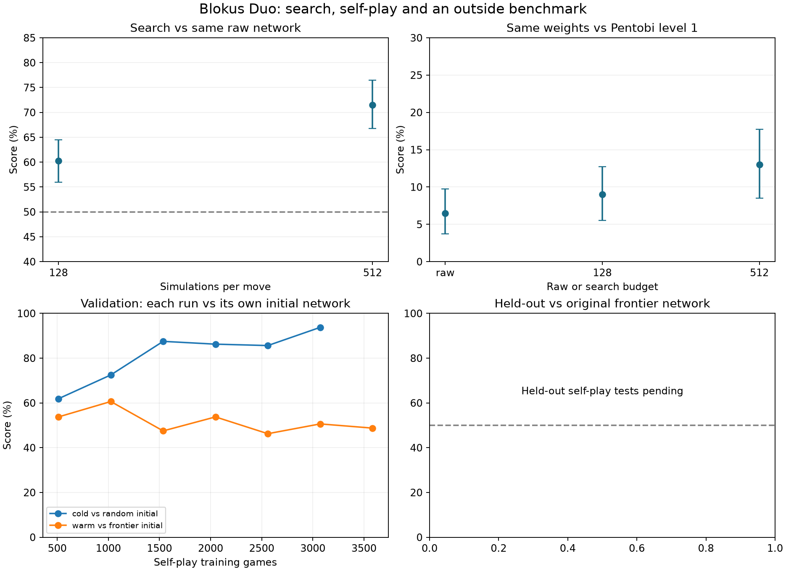

# Blokus search and self-play results

Status: **preliminary; final self-play evaluation pending**.

Score = win + half a draw. Each reported randomized-opening case uses 100 independently generated four-ply openings, each played in both seats. The 95% intervals resample entire two-game opening pairs. Single training seeds do not establish reproducibility across seeds.

## Planning with unchanged weights

| Search budget | Games | W/D/L | Score | Paired 95% interval |
| --- | ---: | --- | ---: | --- |
| 128 simulations | 200 | 116/9/75 | 60.25% | 56.00%–64.50% |
| 512 simulations | 200 | 136/14/50 | 71.50% | 66.75%–76.50% |

Opponent is the same frozen frontier-342 network playing raw. Seed2542000.

## Outside opponent: Pentobi 31.0 level 1

| Policy | Games | W/D/L | Score | Paired 95% interval |
| --- | ---: | --- | ---: | --- |
| raw | 200 | 10/6/184 | 6.50% | 3.75%–9.75% |
| search 128 | 200 | 15/6/179 | 9.00% | 5.50%–12.75% |
| search 512 | 200 | 24/4/172 | 13.00% | 8.50%–17.75% |

All rows share seed2551000 openings and Pentobi seeds, use one Pentobi thread, no book, no resignation, and default avoidance of symmetric draws. Each terminal score margin is independently checked against Rust. These settings do not imply a human rating.

## Self-play budgets and learning

| Run | Finished games | Search simulations | Neural positions evaluated | Wall minutes* |
| --- | ---: | ---: | ---: | ---: |
| cold | 3,456 | 14,707,712 | 12,409,154 | 25.90 |
| warm | 3,584 | 15,822,592 | 13,089,461 | 27.09 |

*Per-run sum of round wall times; the two runs run concurrently. Both use 128 simulations/move, 3 CPU workers, 32 rounds × 128 games, 100 gradient steps/round and 20,000 replay positions. Cold starts randomly; warm starts from frontier-342. Neither uses heuristic or Pentobi training labels. Validation curves have **different reference opponents**: each run plays its own frozen initial network.

## Reserved held-out self-play evaluation

Seed2549000 is never used for checkpoint selection. The selected checkpoint is frozen after training. Raw and search128 are separate agents.

| Run / opponent | Games | W/D/L | Score | Paired 95% interval |
| --- | ---: | --- | ---: | --- |

The in-repo reference is the original frontier-342 network. Largest specialist means longer-margin-243; largest/frontier alone mean hand-written baselines. Normal-start deterministic games are saved separately as exactly two games without an uncertainty estimate. See each held-out protocol for hashes and frozen copies.

### Matched Pentobi comparison on reserved openings

| Policy | Games | W/D/L | Score | Paired 95% interval |
| --- | ---: | --- | ---: | --- |
| original frontier342 raw | 200 | 3/4/193 | 2.50% | 0.75%–4.50% |
| original frontier342 search128 | 200 | 10/7/183 | 6.75% | 3.75%–10.00% |

More search can improve decisions at fixed weights; that does not establish that training produced a better raw network. Stronger internal results do not establish human-level play. Degenerate bootstrap intervals do not prove an exact population score.

Method, commands and preservation details: [rolling experiment](search-experiment.md). Run `python -m blokus_rl.duo_search_report` to regenerate this report.
