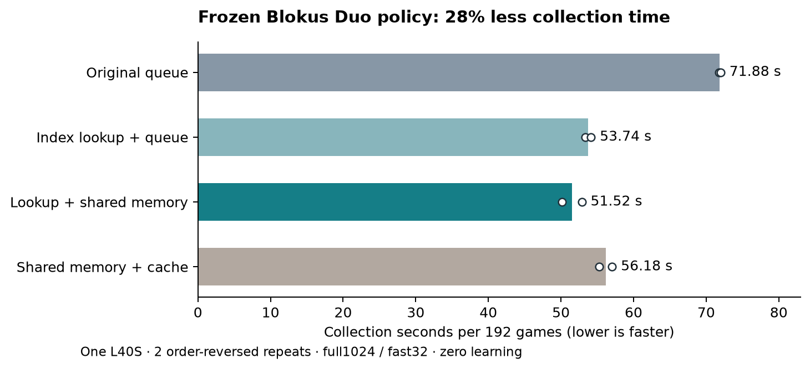

# Blokus Duo inference and checkpoint speedups

Dennis requested stopping the running study and implementing the measured
performance improvements on 27 October 2026. The training app is stopped with
zero tasks, its follow-up is deleted, and all committed state is verified and
backed up. See [the stop record](teacher-search.md) and
[the live profile](teacher-performance-profile.md). Training is not resumed.

## Implemented behavior

- A read-only action-index table replaces per-leaf NumPy geometry conversion.
  It is derived from the Rust placement catalog for both player perspectives,
  includes forced pass, and occupies 71,348 bytes using uint16. Search supplies
  the indices directly to inference and replay; legacy candidate encodings
  remain supported.
- Shared-memory request/response buffers replace pickled inference arrays.
  Queues carry bounded request counts and sequence metadata. Each worker has
  one outstanding request, responses are copied before reuse, and the owner
  unlinks buffers after workers exit. The queue implementation remains available
  for comparison and fallback.
- An optional bounded neural-evaluation LRU also deduplicates identical rows
  within a batch. Keys contain the entire observation plus ordered legal
  indices. Cached outputs precede root noise and include no search statistics.
  A fresh cache is created for each frozen collection round, preventing stale
  outputs after a gradient update. Counters separate logical requested neural
  positions, cache hits and actual GPU-evaluated positions. Cache use remains
  off by default because the measured end-to-end result was slower.
- Atomic replay checkpoints now use flat tensors and lossless bit packing of
  the binary board/inventory/start/player features. Float32 score/pass features,
  float64 terminal targets, ordered indices and uint16 visit counts are retained
  exactly. Old list-format checkpoints remain readable. Optimizer, RNG, model
  and selected-checkpoint state remain in the atomic round file. A stale
  original replay is released after restore rather than pinned in memory.

No rules, rewards, architecture, search counts or expert demonstrations changed.
CUDA batching can already vary floating-point results across scheduling; exact
GPU trajectory identity across implementations is not claimed.

## Validation completed locally

The complete Python suite passed: **89 tests**, 49.64 seconds. This includes
all 27,460 valid placement/perspective/pass checks, queue/shared/cache collection
equivalence, key separation for inventory/player/score/pass/action order,
response lifetime and buffer cleanup, legacy and packed replay recovery,
selected-model initialization and certified tic-tac-toe/environment tests.
The PettingZoo tests emitted their existing API-advice warnings.

A separate frozen best-CNN preflight ran the archived original queue code and
the new shared-memory paths, with and without a cache, on identical seeds and
4 games each. All retained training-record hashes and all 4,480 logical
simulation counts matched exactly on CPU. Its small timing differences are
preflight evidence, not a meaningful estimate of Modal speedup.

On the actual stopped teacher checkpoint's **100,000 replay records**, every
observation, index, visit and target matched after packing and unpacking:

| Local checkpoint measurement | Original | Packed |
| --- | ---: | ---: |
| Bytes | 403,395,919 | 106,659,835 |
| Save seconds | 3.449 | 0.171 |
| Additional packing seconds | — | 0.349 |
| Load seconds | 1.238 | 0.016 |
| Additional unpacking seconds | — | 0.130 |

The artifact is **3.78× smaller**; saving including packing is **6.64× faster**
in this single local measurement. These are storage measurements, not an
end-to-end cloud training multiplier. Original checkpoints were never rewritten.

## Bounded GPU implementation benchmark

Completed `cloud/modal_speed_benchmark.py` and `cloud/duo_speed_benchmark.py`.
This tested collection throughput with frozen weights and **zero gradient
updates**, not playing strength or continuation of the stopped study.

- Immutable original image: im-BnyLYweX6vlwu6iCpDnqrC; original installed module
  hashes are checked. The optimized overlay contains only six project modules,
  its package-path initializer and the benchmark script, approximately 51 KB.
- The existing private round-112 parent is used in place, SHA256
  95569be7c179180c12681255dbcee9884f465e713f418e958a508907beb4d512.
  No model/replay is uploaded.
- Four cases: original queue, lookup with queue, lookup with shared memory,
  and shared memory plus 8,192-entry cache. Two repetitions, reversed case
  order on the second; 192 measured games plus 12 warmup games per case.
- Same small CNN, seeds 1067 and rounds 1/2, six workers, 32 live games,
  full1024 on recorded 20%, fast32 on unrecorded 80%, inference256/leaf8,
  CUDA bfloat16 and TF32 permitted. Report games, simulations, requested versus
  actual neural work and wall time; differing GPU trajectories must not be
  mistaken for identical work.
- One L40S, eight capped cores, 24 GiB, 1,200-second hard limit, retries0,
  max1container. Reservation including startup is **$0.90314333** under a
  **$1.25 phase cap**, from the existing $130 authorization with $50 retained.
  No new training or automatic retry.

The run completed all eight cases: **1,536 measured games plus 96 warmup games**.
It ran from 27 October 23:44:59 to 23:56:32 EDT; measured function work including
warmups and setup took 664.51 seconds. The app stopped with zero tasks.

| Implementation | Repeat 1 seconds | Repeat 2 seconds | Mean seconds | Actual simulations/s |
| --- | ---: | ---: | ---: | ---: |
| Original queue | 71.77 | 72.00 | 71.88 | 21,536 |
| Index lookup + queue | 53.34 | 54.15 | 53.74 | 28,719 |
| Index lookup + shared memory | 52.88 | 50.17 | **51.52** | **29,996** |
| Shared memory + neural cache | 55.30 | 57.05 | 56.18 | 27,529 |



The selected default, **index lookup plus shared memory with neural cache off**,
used **28.32% less collection wall time**, or **1.395× games/s**, than the
original implementation. Actual simulations/s improved **1.393×**. The lookup
accounts for most of the gain: shared memory added 4.13% lower mean time versus
the new queue path in these two repetitions. This is a limited measurement on
one L40S, not a precise general estimate of that smaller incremental effect.

Across both repetitions the original, lookup-queue, shared and cached cases
performed 3,096,096 / 3,086,944 / 3,091,040 / 3,092,928 actual simulations,
respectively. Logical neural requests were 2,416,914 / 2,410,398 / 2,410,236 /
2,411,871; actual evaluated positions were identical to those counts except
for the cached case's 2,077,765. The cache hit 334,106 requests (13.85%) but was
9.03% slower than uncached shared memory. Python hashing, copying and eviction
costs outweighed the saved tiny-CNN evaluations in this workload. This explains
why a neural cache is available for experiments but not enabled by default.

Every case used the same configured game/search budgets and frozen checkpoint;
batch scheduling produced slightly different CUDA trajectories and actual
work. These are collection timings, excluding gradient updates, validation,
checkpoint/Volume commits and startup. They are **not a 1.395× prediction for
the entire old study**, a new learning result, or improved playing strength.
Two order-reversed repeats do not establish uncertainty across machines or
independent training seeds. Saved hashes and counters were checked; this
performance run retained record digests, not action traces for game replay.

The original parent, selected model and all preserved checkpoints remained
unchanged. The original stop record still contains 16,384 control games and
7,168 teacher games; this benchmark did not add optimizer steps to either.
Source commit: `388f93bebac66e89be78806bdb06070d08373ad5`. App:
`ap-ATRf6AnQsY5dSgOGQvpMXl`. Exact source/runner/payload hashes and the one-shot
reservation are in `runs/modal-speed-benchmark-cost-ledger.jsonl`.

Final downloaded artifacts and stopped-app/provider snapshots are in
`runs/duo-speed-benchmark-final-20261028T035657Z/`. Reproduce the audit without
launching any games:

```sh
.venv/bin/python runs/duo-speed-benchmark-verify.py runs/duo-speed-benchmark-final-20261028T035657Z
MPLCONFIGDIR=.cache/matplotlib .venv/bin/python runs/duo-speed-benchmark-plot.py
```

The verifier checked all eight result files against the completed manifest,
identical config, source commit/payload/baseline hashes, model size/hash,
simulation accounting, logical versus physical neural work, zero gradient
updates, preserved atomic states and stopped compute. Provider metering for
the benchmark was **$0.47469682**, below the **$0.90314333 reservation** and
$1.25 cap. The stopped training study's three apps remain **$9.81204170** in
the final provider snapshot. These are actual metered costs, not reservations.
The $50 reserve remains intact. No training was restarted.

All new speed artifacts, exact payload, verifier, plot script and local timing
records are backed up in `.backups/duo-speedups-20261027.tar.gz`; every archived
member was read back and hash-verified. The large stopped checkpoints have
their separate verified backup documented in the stop record.

## Runtime and compatibility

`python -m blokus_rl.duo_deep` accepts `--inference-transport queue|shared_memory`
and `--inference-cache-entries N`, defaulting to shared memory and zero cache
entries. These execution options are recorded in new
atomic checkpoints and must match on exact recovery. A new branch chooses its
own runtime; old legacy checkpoints have no runtime declaration and remain
loadable. A source-upgraded continuation is a new implementation lineage and
must be recorded explicitly rather than relabeled as the original study.

Compiled/CUDA-graph inference, persistent subtree reuse and asynchronous Volume
commits remain candidates, not claimed implemented gains. Subtree reuse changes
budget accounting; asynchronous persistence needs stronger failure tests.
Compact atomic checkpoints address the measured storage cost without weakening
recovery guarantees.

See [the further local evaluation](further-speedups.md) for the next candidates:
corner-indexed move generation/PUCT prototypes, bulk inference handoff and a
ranked GPU follow-up plan. Those experimental measurements do not change these
production defaults or restart training.
